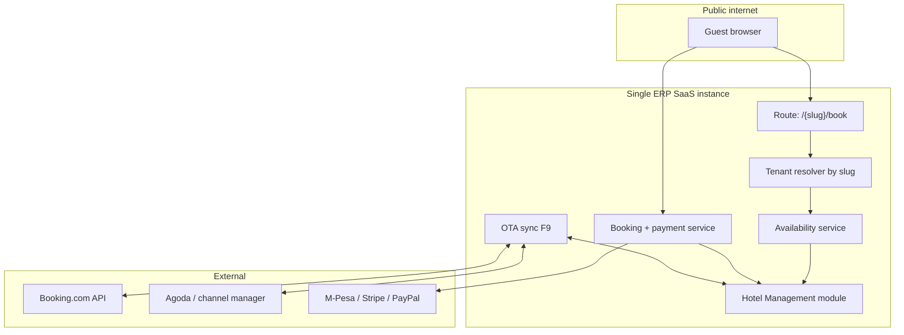

# Hotel Direct Booking Website — SaaS Architecture & Implementation Plan

**Version:** 1.0  
**Date:** 2026-06-11  
**Status:** F10 complete (OTA F9 + live payments F11 deferred)  
**Related:** `HOTEL_MODULE_COMPLETION_PLAN.md` — Future phases F9, F10, F11

---

## 1 — Client requirement (summary)


| Requirement     | Description                                                                          |
| --------------- | ------------------------------------------------------------------------------------ |
| Hotel website   | Each hotel/company has a public booking page                                         |
| Direct booking  | Guest selects dates → room type → (optional room) → pays online                      |
| ERP integration | Booking creates a reservation in **that company’s** hotel module automatically       |
| Channel sync    | Booking.com / Agoda (OTA) sync at **company level** so availability stays consistent |


---

## 2 — SaaS answer: one platform, many hotels

This is a **multi-tenant SaaS** product. Data is already isolated per company via `created_by` / `creatorId()` on all hotel tables (`hotel_rooms`, `hotel_reservations`, etc.).

Each hotel (tenant) does **not** need a separate codebase or server. They need:

1. A **public identity** (URL slug or domain)
2. **Branding** (name, logo, photos, policies)
3. **Payment keys** (their own gateway account, optional)
4. **OTA credentials** (their Booking.com property, optional)

All run on the same ERP instance; the app resolves **which company** the guest belongs to from the URL.

---

## 3 — URL structure (recommended vs optional)

### Option A — Path-based (recommended for MVP) ✅

```
https://erpsaas.uthara.co.mz/matolavillage
https://erpsaas.uthara.co.mz/hoyahoya
```


| Pros                                                  | Cons                      |
| ----------------------------------------------------- | ------------------------- |
| No wildcard DNS or extra SSL                          | URL shows platform domain |
| Works on Laragon / single vhost immediately           | Less “white label” feel   |
| Same as many SaaS tools (Notion, Shopify admin paths) |                           |


**This matches your conclusion:** subdomain per hotel (`matolavillage.uthara.co.mz`) is optional later; **path slug is enough to start.**

### Option B — Subdomain (phase 2+)

```
https://matolavillage.uthara.co.mz
https://hoyahoya.uthara.co.mz
```

Requires: wildcard DNS `*.uthara.co.mz`, wildcard SSL, middleware to read tenant from host.

### Option C — Custom domain (enterprise)

```
https://matolavillage.com  →  CNAME → erpsaas.uthara.co.mz
```

Requires: per-hotel domain verification, SSL (Let’s Encrypt or Cloudflare), `hotel_booking_sites.custom_domain` mapping.

**Recommendation:** Ship **Option A** first; add B/C when a client pays for white-label.

---

## 4 — High-level architecture




### Tenant resolution (path-based)

```
GET /matolavillage          →  company where booking_slug = 'matolavillage'
GET /matolavillage/rooms    →  same tenant, room catalog
POST /matolavillage/book    →  create HotelReservation(created_by = company_id, source = 'online')
```

Middleware: `ResolveHotelBookingTenant` — loads company + `HotelBookingSite` config; 404 if slug unknown or site disabled.

---

## 5 — Guest booking flow (UX)

```
1. Landing     →  Hotel name, photos, amenities, “Book now”
2. Dates       →  Check-in / check-out (calendar)
3. Availability→  Room types with price/night (only types with free inventory)
4. Options     →  Adults, children, addons (extra bed, breakfast) — reuse Phase 2 catalog
5. Guest info  →  Name, email, phone, ID (optional)
6. Payment     →  Deposit or full prepay (company setting)
7. Confirm     →  Reservation no + email; appears in ERP as status = confirmed, source = online
```

**ERP staff see:** Reservations list → same record as manual booking → check-in at front desk as today.

---

## 6 — Availability engine (single source of truth)

Reuse existing logic (no double booking):


| Input          | Already in codebase                                                             |
| -------------- | ------------------------------------------------------------------------------- |
| Room conflicts | `HotelReservationController::roomHasConflict()` / `HotelStayOperationsService`  |
| Room status    | `HotelRoomStatusService` — exclude maintenance/cleaning for new online bookings |
| Occupancy      | `HotelAddonService::validateOccupancyForBooking()`                              |
| Rates          | `HotelReservationPricingService::quote()`                                       |


**Availability rule (per night, per room type):**

```
available_count = rooms_of_type
  − reservations overlapping dates (pending, confirmed, checked_in)
  − optional OTA holds (allotment blocks from channel manager)
```

Public API (internal JSON, no auth for read-only availability):

- `GET /api/public/hotel/{slug}/availability?check_in=&check_out=&adults=&children=`
- `GET /api/public/hotel/{slug}/quote?room_type_id=&...`

---

## 7 — OTA (Booking.com / Agoda) at company level

Already stubbed: `hotel_ota_settings`, `hotelmanagement:ota-sync` (logs only).


| Direction                | Behaviour                                                                                                |
| ------------------------ | -------------------------------------------------------------------------------------------------------- |
| **Outbound** (ERP → OTA) | When reservation created/updated/cancelled in ERP or on website → push availability/rates to channel API |
| **Inbound** (OTA → ERP)  | Webhook or poll → create/update `HotelReservation` with `source = 'ota'`, external_id on reservation     |


**Same calendar** for:

- Front desk manual bookings  
- Website (`source = online`)  
- OTA (`source = ota`)

Prevents overbooking if sync runs every 15 minutes (existing schedule) + immediate push on booking.

**Phase order:** Direct website (F10) **before** full OTA (F9) is OK — website uses same availability service; OTA plugs in later without rewriting bookings.

---

## 8 — Payments (company-level)


| Setting   | Stored per company                                                |
| --------- | ----------------------------------------------------------------- |
| Gateway   | stripe / paypal / mpesa / manual                                  |
| API keys  | encrypted in `hotel_booking_sites` or `hotel_accounting_settings` |
| Deposit % | 0–100% or full prepay                                             |


On successful payment:

1. Create `HotelReservation` + optional `HotelFolioPayment` or ERP `Invoice` prepayment
2. Send confirmation email (reuse `HotelReservationCreatedMail`)
3. Reduce availability for dates

On payment failure: no reservation (or hold 15 min then release — optional).

---

## 9 — Data model (new tables)

### `hotel_booking_sites` (one per company, or per property/branch later)


| Column                                   | Purpose                                        |
| ---------------------------------------- | ---------------------------------------------- |
| `created_by`                             | Company owner id (tenant)                      |
| `slug`                                   | URL segment: `matolavillage` (unique globally) |
| `custom_domain`                          | nullable — `matolavillage.com`                 |
| `is_published`                           | On/off public site                             |
| `display_name`                           | Public hotel name                              |
| `tagline`, `description`                 | Marketing copy                                 |
| `logo_path`, `cover_image_path`          | Branding                                       |
| `contact_email`, `contact_phone`         | Guest support                                  |
| `policies_json`                          | Cancellation, check-in times                   |
| `payment_gateway`, `payment_config_json` | Encrypted keys                                 |
| `require_prepayment_percent`             | 0–100                                          |
| `default_language`                       | en / pt / …                                    |


### `hotel_reservations` (extend existing)


| Column               | Purpose                                    |
| -------------------- | ------------------------------------------ |
| `external_id`        | OTA booking id                             |
| `online_payment_ref` | Gateway transaction id                     |
| `booking_site_id`    | nullable FK — which public site created it |


`source` already supports: `manual`, `walkin`, `online`, `ota`.

---

## 10 — Routes (Laravel)

### Public web (guest-facing)

```php
Route::prefix('{hotelSlug}')->middleware(['hotel.tenant', 'XSS'])->group(function () {
    Route::get('/', [PublicHotelController::class, 'home']);
    Route::get('/rooms', [PublicHotelController::class, 'rooms']);
    Route::post('/availability', [PublicHotelController::class, 'availability']);
    Route::get('/book', [PublicHotelController::class, 'checkoutForm']);
    Route::post('/book', [PublicHotelController::class, 'storeBooking']);
    Route::get('/confirmation/{token}', [PublicHotelController::class, 'confirmation']);
    Route::post('/payment/callback', [PublicHotelController::class, 'paymentCallback']);
});
```

Register **before** authenticated hotel admin routes to avoid conflicts.

### Admin (inside ERP, authenticated)

```php
Route::get('hotel/booking-site', ...)->name('hotel.booking-site.edit');
Route::post('hotel/booking-site', ...)->name('hotel.booking-site.update');
Route::get('hotel/booking-site/preview', ...);  // open /{slug} in new tab
```

---

## 11 — Implementation phases

### Phase F10 — Direct booking website (3–4 weeks)


| #     | Task                                                              | Status |
| ----- | ----------------------------------------------------------------- | ------ |
| F10.1 | Migration `hotel_booking_sites` + slug unique index               | ✅ |
| F10.2 | Admin UI: slug, branding, publish toggle, preview link            | ✅ |
| F10.3 | `HotelPublicAvailabilityService` — wrap pricing + conflict checks | ✅ |
| F10.4 | Public Blade pages: home, search, book, confirmation            | ✅ |
| F10.5 | `POST` booking → `HotelReservation` + guest + addons              | ✅ |
| F10.6 | Confirmation email + public confirmation page (signed token)      | ✅ |
| F10.7 | i18n (pt/en) for public strings                                   | ✅ |


**Acceptance:** Guest books at `/matolavillage` → reservation visible in ERP with `source = online`.

---

### Phase F11 — Online payments (2 weeks)


| #     | Task                                                   | Status |
| ----- | ------------------------------------------------------ | ------ |
| F11.1 | Company payment settings UI (reuse ERP Settings)       | ✅ |
| F11.2 | Stripe Checkout for hotel bookings                       | ✅ |
| F11.3 | Webhook `checkout.session.completed` + idempotency     | ✅ |
| F11.4 | Folio prepayment or invoice on book                    | ⏳ deferred |
| F11.5 | M-Pesa integration (Mozambique)                        | ⏳ deferred |


**Acceptance:** Paid booking only confirmed after gateway success.

---

### Phase F9 — Channel manager / OTA (3–5 weeks)


| #    | Task                                       |
| ---- | ------------------------------------------ |
| F9.1 | Real `OtaSyncCommand` — availability push  |
| F9.2 | Inbound reservation webhook                |
| F9.3 | `external_id` + conflict resolution rules  |
| F9.4 | Admin mapping: room types ↔ OTA room codes |


**Acceptance:** Booking.com booking appears in ERP; website + desk see reduced availability.

---

### Phase F12+ — Polish


| #   | Task                                                    |
| --- | ------------------------------------------------------- |
| F12 | Custom domain + SSL automation                          |
| F13 | Subdomain wildcard                                      |
| F14 | Multi-property (one company, several hotels / branches) |


---

## 12 — What to tell the client (short)

**Urdu/English pitch:**

> Ye SaaS hai — ek platform par saari companies ka data alag alag secure rehta hai. Har hotel ki booking website usi company ke hotel module se linked hogi.  
>
> Shuruat mein URL is tarah hogi: **erpsaas.uthara.co.mz/matolavillage** — alag subdomain ya alag server ki zaroorat nahi. Baad mein agar chahain to **matolavillage.com** custom domain bhi laga sakte hain.  
>
> Website se booking → seedha ERP reservations mein. Booking.com / Agoda bhi company level par sync hoga taake double booking na ho.

---

## 13 — Security & operations


| Topic            | Approach                                                    |
| ---------------- | ----------------------------------------------------------- |
| Tenant isolation | Slug resolves to single `created_by`; all queries scoped    |
| Rate limiting    | Throttle public book + availability endpoints per IP        |
| Bots             | CAPTCHA on book submit (optional)                           |
| PII              | Guest data same as `hotel_guests` — GDPR-style export later |
| SEO              | Per-site meta title/description from `hotel_booking_sites`  |


---

## 14 — Effort summary


| Phase         | Duration  | Depends on               |
| ------------- | --------- | ------------------------ |
| F10 Website   | 3–4 weeks | Phases 0–8 ✅ done        |
| F11 Payments  | 2 weeks   | F10                      |
| F9 OTA        | 3–5 weeks | F10 availability service |
| Custom domain | 1 week    | F10 + DevOps             |


**Minimum client demo (2 weeks):** F10.1–F10.5 only — book without live payment (pay at hotel).

---

## 15 — Next step

1. Confirm URL style: `**erpsaas.uthara.co.mz/{slug}`** for v1
2. Confirm payment providers for Mozambique (M-Pesa, e-Mola, card)
3. Pick one OTA for v1 (usually Booking.com Connectivity)
4. Start F10.1 migration + admin slug field on company/hotel settings

---

*Extends `HOTEL_MODULE_COMPLETION_PLAN.md` Part 5 (Future Phases). Update when F10+ work begins.*