# ERP SaaS — Technical Documentation


> **Last updated:** 2026-08-07  

This document describes how the ERP SaaS codebase works: architecture, tenancy, auth, and each business module.

---

## Table of contents

1. [Overview and architecture](#1-overview-and-architecture)
2. [Setup and environment](#2-setup-and-environment)
3. [Tenancy, plans, and auth](#3-tenancy-plans-and-auth)
4. [Accounting](#4-accounting)
5. [HRM](#5-hrm)
6. [CRM](#6-crm)
7. [Projects](#7-projects)
8. [Inventory / products](#8-inventory--products)
9. [POS](#9-pos)
10. [Users, RBAC, and settings](#10-users-rbac-and-settings)
11. [SaaS billing and payments](#11-saas-billing-and-payments)
12. [Collaboration](#12-collaboration)
13. [LandingPage module](#13-landingpage-module)
14. [HotelManagement module](#14-hotelmanagement-module)
15. [Reports and tax / compliance](#15-reports-and-tax--compliance)
16. [Deployment and operations](#16-deployment-and-operations)
17. [Glossary](#17-glossary)

---

## 1. Overview and architecture

### 1.1 What this product is

This repository is a **multi-tenant ERP SaaS** built on **Laravel 11** (PHP 8.2+). A single application serves:

- A **super admin** who manages companies, plans, coupons, and platform settings
- Many **company tenants** (each company is a row in `users` with `type = company`)
- Company **staff**, **clients**, and related records (customers, vendors, employees)

Business capabilities are sold as **Plan feature flags** (Accounting, HRM, CRM, Projects, POS, Stock, ChatGPT). Two optional product areas live as **nwidart Laravel modules**:

| Module | Path | Status file |
|--------|------|-------------|
| LandingPage | `Modules/LandingPage/` | `modules_statuses.json` → `true` |
| HotelManagement | `Modules/HotelManagement/` | `modules_statuses.json` → `true` |

Core ERP (Accounting, HRM, CRM, Projects, Inventory, POS, billing, etc.) lives in the main app (`app/`, `resources/views/`, `routes/web.php`), not as separate nwidart packages.

### 1.2 Tech stack

| Layer | Technology |
|-------|------------|
| Backend | Laravel 11, PHP ^8.2 |
| Auth / ACL | Laravel UI auth, Spatie Permission, Sanctum, Lab404 Impersonate, Google2FA (`pragmarx/google2fa`) |
| Modules | `nwidart/laravel-modules` ^11.1 |
| UI | Blade templates, Vite 5 + `laravel-vite-plugin`, Axios |
| Chat | Chatify (`munafio/chatify`) |
| Export / PDF | Maatwebsite Excel, DomPDF, Browsershot |
| Installer | `rachidlaasri/laravel-installer` |
| Storage | Local disk + optional AWS S3 (`league/flysystem-aws-s3-v3`) |
| Payments | Many gateway SDKs (Stripe, PayPal, Mollie, Midtrans, MercadoPago, etc.) |

Approximate size of core app surface:

- ~194 HTTP controllers under `app/Http/Controllers/`
- ~234 Eloquent models under `app/Models/`
- Primary route file: `routes/web.php` (monolithic ERP surface)
- Auth routes: `routes/auth.php`
- Limited API: `routes/api.php`

### 1.3 High-level architecture

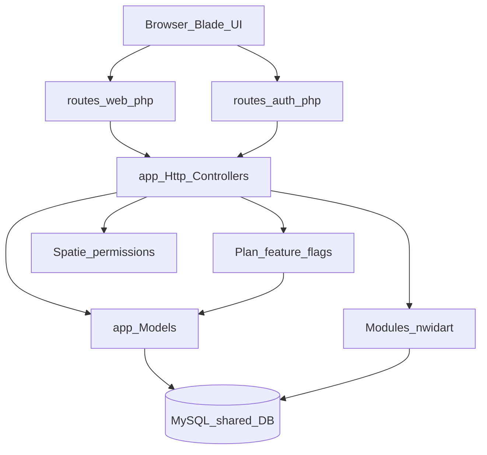

**Important design choice:** tenancy is **shared database, company-scoped**, not separate databases per tenant and not a package like Stancl Tenancy. Almost every business query filters by `created_by` equal to `Auth::user()->creatorId()` (the active company owner id).

### 1.4 Directory map

| Path | Role |
|------|------|
| `app/Http/Controllers/` | All core ERP + SaaS admin controllers (flat namespace) |
| `app/Models/` | Eloquent models (`User`, `Plan`, `Invoice`, `Employee`, …) |
| `app/Services/` | Domain services (e.g. trial balance, TOTP, bank reconciliation, hotel-related helpers where present in core) |
| `routes/web.php` | Main authenticated + public business routes |
| `routes/auth.php` | Login, register, password reset, 2FA challenge |
| `resources/views/` | Blade UI; domain folders mirror features (`invoice/`, `employee/`, `pos/`, …) |
| `resources/views/partials/admin/menu.blade.php` | **Canonical sidebar / module map** |
| `Modules/LandingPage/` | Public marketing CMS |
| `Modules/HotelManagement/` | Hotel PMS |
| `database/migrations/` | Schema for core app |
| `config/modules.php` | nwidart modules config |
| `modules_statuses.json` | Enable/disable LandingPage & HotelManagement |
| `docs/` | Ops / hotel / migration notes; **this file** is the main tech doc |

Controllers are **not** namespaced by domain (no `App\Http\Controllers\Accounting\…`). Domain boundaries are defined by:

1. Sidebar menu + Plan flags  
2. Spatie permission names  
3. Model / view folder naming  

### 1.5 Request lifecycle (typical authenticated page)

1. User hits a route in `routes/web.php` (middleware: `auth`, often `XSS`, `revalidate`).
2. Controller checks permissions (`@can` / `$user->can(...)`) and sometimes plan flags.
3. Queries scope data with `created_by = Auth::user()->creatorId()` (or equivalent).
4. Blade view under `resources/views/{feature}/` renders the UI.
5. Settings (logo, currency, theme) often come from `App\Models\Utility::settings()`.

### 1.6 Plan ↔ module matrix

| Plan column (`plans` table) | Menu / product area |
|-----------------------------|---------------------|
| `account` | Accounting System (+ accounting dashboards/reports) |
| `hrm` | HRM System |
| `crm` | CRM System |
| `project` | Project System |
| `pos` | POS System |
| `stock` | Products / Inventory System |
| `chatgpt` | AI template / grammar features |

Limits on the same plan row: `max_users`, `max_customers`, `max_venders`, `max_clients`, `max_pos_users`, `storage_limit`. Value `-1` generally means unlimited.

Hotel and LandingPage are **not** Plan columns; they are toggled via `modules_statuses.json`.

---

## 2. Setup and environment

### 2.1 Prerequisites

- PHP 8.2+ with extensions required by Laravel 11
- Composer
- MySQL (Laragon MySQL is the usual local choice on Windows)
- Node.js + npm (for Vite asset build)
- Optional: Redis, Mailhog, AWS S3 credentials

### 2.2 Local install (Laragon-style)

```bash
# From project root: C:\laragon\www\erp-saas
composer install
copy .env.example .env   # Windows; or cp on Linux/macOS
php artisan key:generate

# Edit .env: DB_DATABASE, DB_USERNAME, DB_PASSWORD, APP_URL
php artisan migrate
php artisan module:discover
# If modules need schema/data:
php artisan module:migrate
php artisan module:seed

npm install
npm run build   # or npm run dev for Vite HMR
```

First-time installs may also use the web installer package (`rachidlaasri/laravel-installer`) if enabled on the environment.

Ensure storage is writable:

```bash
php artisan storage:link
```

### 2.3 Important `.env` keys

From `.env.example` (extend as needed for gateways in production):

| Key | Purpose |
|-----|---------|
| `APP_URL` | Base URL (must match how you open Laragon/vhost) |
| `DB_*` | MySQL connection |
| `CACHE_DRIVER` / `SESSION_DRIVER` | Default `file` locally |
| `QUEUE_CONNECTION` | Default `sync` locally; use `database`/`redis` in production for jobs |
| `MAIL_*` | SMTP / Mailhog for outbound mail |
| `AWS_*` | Optional S3 for uploads |
| `FILESYSTEM_DISK` | `local` or `s3` |

Payment gateway secrets are typically stored in **company/system settings** (database) and/or additional env keys not fully listed in `.env.example`.

### 2.4 Enabling product modules

Edit `modules_statuses.json`:

```json
{
    "LandingPage": true,
    "HotelManagement": true
}
```

Then run `php artisan module:discover` (and migrate/seed if required). Menu injection for Hotel uses Blade includes such as `@include('hotelmanagement::menu.hotelmanagement')` from the admin menu.

### 2.5 How to find “where does feature X live?”

1. Search the sidebar: `resources/views/partials/admin/menu.blade.php`
2. Note the `route('...')` name
3. Resolve the route in `routes/web.php` (or `Modules/*/Routes/`)
4. Open the controller method and related model/view folder

---

## 3. Tenancy, plans, and auth

### 3.1 User types

The `users.type` column drives identity:

| Type | Meaning |
|------|---------|
| `super admin` | Platform owner; manages companies, plans, global settings |
| `company` | Tenant owner account; holds `plan`, `plan_expire_date`, storage limits |
| Staff / custom role types | Company users created under a company (`created_by` → company id); Spatie roles apply |
| `client` | Project client user (portal-style access); limited menus |

Related entities (not always `users` rows):

- `customers` — AR / sales customers  
- `venders` — AP vendors  
- `employees` — HR employee profiles (often linked to a login user)

### 3.2 Tenant identity: `creatorId()`

Primary implementation: `App\Models\User::creatorId()`.

```text
if type == super admin  → return this user's id
if type == company      → return activeCompanyId() ?? this user's id
else (staff/client)     → return activeCompanyId() ?? created_by
```

**Convention used everywhere:** store and query tenant data with `created_by = Auth::user()->creatorId()`.

There is **no** ubiquitous `company_id` column on every table. Understanding `creatorId()` is mandatory before writing any new feature.

### 3.3 Multi-company membership

Supporting pieces:

| Piece | Role |
|-------|------|
| `company_user` pivot | `user_id`, `company_id`, `role`, `status`, `is_default` |
| `users.default_company_id` | Preferred company |
| `session('active_company_id')` | Currently selected company for the request |
| `User::canAccessCompany($id)` | Authorization check for switching |
| `User::activeCompanyId()` | Resolves session → default → first active membership |
| `User::companies()` / `companiesForSelection()` | UI company switcher |

Flow:

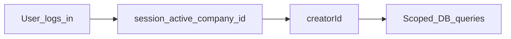

### 3.4 Super admin impersonation

Routes (authenticated):

- `users/{id}/login-with-company` → `login.with.company` → `UserController::LoginWithCompany`
- `login-with-company/exit` → `exit.company` → `UserController::ExitCompany`

Uses Lab404 Impersonate (`Impersonate` trait on `User`). UI can detect impersonation via `@impersonating`.

### 3.5 Plans and feature gating

Model: `App\Models\Plan` (`plans` table).

Company user stores:

- `users.plan` → plan id  
- `users.plan_expire_date`  
- related trial / requested plan fields  

`User::assignPlan($planID, $company_id = 0)`:

1. Sets plan id and expiry from plan `duration` (`month` / `year` / lifetime → null expiry)
2. Activates or deactivates existing users/clients/customers/vendors to enforce `max_*` limits

**UI gating example** (sidebar): load plan via `Plan::getPlan(Auth::user()->show_dashboard())`, then:

```blade
@if ($userPlan->account == 1 && Gate::check('show account dashboard'))
    ...
@endif
```

So access requires **both**:

1. Plan flag enabled (`account` / `hrm` / … = 1)  
2. Spatie permission for that action  

POS user limits use helpers on `Plan`:

- `Plan::countPosUsersForCompany($creatorId)`
- `Plan::canCompanyAddPosUser($creatorId, $excludeUserId)`

### 3.6 Authentication stack

| Concern | Implementation |
|---------|----------------|
| Session login | `routes/auth.php` → `AuthenticatedSessionController` |
| Registration | `RegisteredUserController` (optional referral `ref_id`) |
| POS login | `POST /login/pos` → `storePosLogin` (PIN / POS-oriented login) |
| Email verify | Laravel MustVerifyEmail on `User` + verify routes |
| Password reset | Standard Laravel UI reset flow |
| API tokens | Laravel Sanctum (`HasApiTokens`) |
| Roles / permissions | Spatie (`HasRoles` on `User`; also used on Customer/Vender where applicable) |
| 2FA | Google2FA; challenge routes `2fa.challenge` / `2fa.challenge.verify` |
| 2FA manage | Authenticated: `2fa/enable`, `2fa/disable`, `2fa/recovery-codes` |

2FA-related user fields: `two_factor_enabled`, `two_factor_secret`, `two_factor_recovery_codes`.

### 3.7 Permission model (practical)

- Permissions are named in human-readable Spatie style, e.g. `manage invoice`, `show account dashboard`, `manage pos`.
- Blade uses `@can('...')` / `Gate::check('...')`.
- Company admins assign roles via User / Role / Permission controllers and views (`user/`, `role/`, `permission/`).

When adding a new screen:

1. Add permission (seeder or admin UI)  
2. Gate the route/controller/menu  
3. Scope queries by `creatorId()`  
4. If it is a sellable product area, also gate with the correct Plan flag  

### 3.8 Branch and warehouse scoping (related to tenancy)

Beyond company tenancy, operational isolation often uses:

- `Branch` + user–branch assignment  
- `users.pos_branch_id`, `users.warehouse_id`  
- POS and stock flows frequently filter by branch/warehouse inside the company  

Always check whether a feature is **company-scoped only** or **company + branch/warehouse scoped**.

### 3.9 Gotchas

1. **Never filter only by `Auth::id()`** for tenant data — use `creatorId()` unless the record is intentionally user-personal.
2. **Company type users** are both a login and the tenant root; deleting/disabling a company affects all `created_by` children.
3. **Plan limits** deactivate excess users (`is_active = 0`) on `assignPlan` — bugs around “user cannot login” are often plan limit related.
4. **Menu hidden ≠ API secured** — always enforce permissions in controllers, not only Blade.
5. **Modules vs Plan** — Hotel can be enabled in `modules_statuses.json` while Accounting is off on the plan; treat them as independent gates.

---

## 4. Accounting

**Plan flag:** `plans.account == 1`  
**Canonical menu:** `resources/views/partials/admin/menu.blade.php` (two top-level areas when Accounting is enabled)  
**Permission examples:** `show account dashboard`, `manage invoice`, `manage bill`, `manage bank account`, `trial balance report`, `tax report`, …

### 4.1 Purpose and who uses it

Accounting covers company finance: bank accounts, customer sales (AR), supplier purchases (AP), double-entry ledger, budgets, financial goals, and accounting setup (tax, categories, units, custom fields, print).

Typical roles: company admin, accountant, sales clerk (invoices), purchasing clerk (bills).

When the plan enables Accounting, the sidebar exposes:

1. **Accounting** (dashboard + reports) — needs `show account dashboard` (and report-specific permissions)
2. **Accounting System** — Banking, Sales, Purchases, Double Entry, Budget, Financial Goal, Accounting Setup, Print Settings

Detailed tax/report document numbers (VAT Modelo A, IRPS, DRE, etc.) are expanded further in [Section 15](#15-reports-and-tax--compliance); this section focuses on operational Accounting.

### 4.2 Folder map

| Area | Controllers (`app/Http/Controllers/`) | Models (`app/Models/`) | Views (`resources/views/`) |
|------|----------------------------------------|------------------------|----------------------------|
| Banking | `BankAccountController`, `BankTransferController`, `BankReconciliationController`, `TransactionController` | `BankAccount`, `BankTransfer`, `Transaction`, `BankReconciliationSession`, `BankStatementLine`, `BankReconciliationMatch` | `bankAccount/`, `bank-transfer/`, `bankReconciliation/`, `transaction/` |
| Sales / AR | `CustomerController`, `ProposalController`, `InvoiceController`, `QuotationController`, `ProformaController`, `RevenueController`, `CreditNoteController` | `Customer`, `Proposal`, `Invoice`, `InvoiceProduct`, `InvoicePayment`, `Quotation`, `Proforma`, `Revenue`, `CreditNote` | `customer/`, `proposal/`, `invoice/`, `quotation/`, `proforma/`, `revenue/`, `creditNote/` |
| Purchases / AP | `VenderController`, `PurchaseQuotationController`, `PurchaseController`, `BillController`, `ExpenseController`, `PaymentController`, `DebitNoteController`, `BillCreditNoteController` | `Vender`, `Purchase`, `Bill`, `BillProduct`, `BillAccount`, `BillPayment`, `Payment`, `DebitNote`, `Expense` | `vender/`, `vendor_quote/`, `purchase/`, `bill/`, `expense/`, `payment/`, `debitNote/` |
| Double entry | `ChartOfAccountController`, `ChartOfAccountTypeController`, `JournalEntryController`, `FiscalYearClosingController` | `ChartOfAccount`, `ChartOfAccountType`, `ChartOfAccountSubType`, `JournalEntry`, `JournalItem`, `TransactionLines` | `chartOfAccount/`, `journalEntry/`, `fiscalYearClosing/` |
| Budget / goals | `BudgetController`, `GoalController` | `Budget`, `Goal` | `budget/`, `goal/` |
| Setup | `TaxController`, category/unit/custom field controllers, print via `SystemController` | `Tax`, `ProductServiceCategory`, `ProductServiceUnit`, `CustomField`, … | `taxes/`, `customFields/`, setup layouts |
| Logistics (sales-linked) | `DeliveryNoteController`, `RoadManifestController`, `RoadTransportRecordController` | `DeliveryNote`, `RoadManifest`, `RoadTransportRecord` | `delivery_note/`, `road_manifest/`, `road_transport_record/` |

**Key services (`app/Services/` and `app/Services/Accounting/`):**

| Service | Role |
|---------|------|
| `DocumentLedgerService` | Balance document GL lines (e.g. Invoice Receivable) |
| `JournalEntryPoster` | Post journal entries into ledger lines |
| `ChartAccountResolver` | Resolve chart accounts for documents |
| `DocumentVoidService` | Void invoices/bills with audit trail |
| `InvoiceSaleDeductionService` | Stock deduction when configured on invoice |
| `FiscalYearClosingService` | Fiscal year close |
| `VatSettlementService` | VAT settlement helpers |
| `CustomerCreditLimitService` | Customer credit limits |
| Bank reconciliation package | `app/Services/Accounting/BankReconciliation/` (`StatementImportService`, `ReconciliationMatcher`, presets including `BciMozambiquePreset`) |

**Utility helpers** (`app/Models/Utility.php`) used constantly: `addTransactionLines`, `updateUserBalance` / `userBalance`, `bankAccountBalance`, tax helpers, document number formatters (`invoiceNumberFormat`, `billNumberFormat`, …), stock helpers, `settings` / `settingsById`.

### 4.3 Key tables

| Table | Purpose |
|-------|---------|
| `bank_accounts`, `bank_transfers`, `transactions` | Banking |
| Bank recon session / statement / match tables | Imported statements and matches |
| `customers`, `invoices`, `invoice_products`, `invoice_payments`, `credit_notes`, `revenues` | AR |
| `venders`, `purchases`, `bills`, `bill_products`, `bill_payments`, `payments`, `debit_notes` | AP |
| `chart_of_accounts`, `chart_of_account_types`, `journal_entries`, `journal_items` | COA + manual journals |
| `transaction_lines` | Operational GL lines for documents and approved journals |
| `budgets`, `goals` | Planning |
| `document_void_logs` | Void audit |
| `delivery_notes`, `road_manifests`, transport record tables | Delivery / logistics |

Tenant scope: almost all of the above filter by `created_by = Auth::user()->creatorId()`.

### 4.4 Menu subgroups (Accounting System)

| Subgroup | Features |
|----------|----------|
| Banking | Accounts, transfers, bank reconciliation |
| Sales | Customer, Estimate (proposal), Invoice, Quotation, Proforma, Revenue, Credit Note, Debit Note (sale) |
| Purchases | Supplier (`vender`), Vendor Quote, Purchase Order, Bill, Expense, Payment, Debit Note, Credit Note (bill) |
| Double Entry | Chart of Accounts, Journal Account, Fiscal year closing |
| Budget Planner | Company-type budget UI |
| Financial Goal | Goals |
| Accounting Setup | Taxes, Price Levels, Category, Unit, Custom Field |
| Print Settings | `print.setting` |

Road manifest / delivery note are **not** separate Accounting menu roots; they hang off invoice / delivery-note flows (permissions typically reuse `show invoice`).

### 4.5 Main flow: create and release an invoice

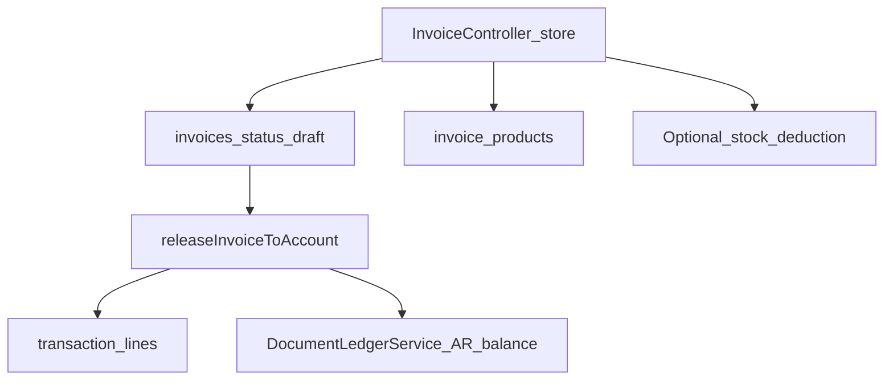

**Create (`InvoiceController::store`):**

1. Opens a DB transaction.
2. Inserts `invoices` row — typically status `0` (draft); may link proforma / quotation / purchase sources.
3. Saves custom fields via `CustomField::saveData`.
4. Inserts `invoice_products` line items (qty, tax, discount, price, product identifiers).
5. If company setting `stock_deduction_timing === 'invoice'`, calls `InvoiceSaleDeductionService::deductLine(...)` and stamps deduction metadata.
6. May mark source documents as converted.

**Not created at store time:** `journal_entries` / `journal_items`, and normally no AR `transaction_lines` until the invoice is released/sent.

**Release / send (`releaseInvoiceToAccount` and related send/authorize paths):**

1. Posts product income lines to COA (`sale_chartaccount_id`) with reference `'Invoice'`.
2. Balances receivables via `DocumentLedgerService::balanceDocumentLines(..., 'Invoice Receivable')`.
3. Ledger reality for reports is largely in **`transaction_lines`**, not only classic journal tables.

### 4.6 Payments, customer balance, banks

When an invoice payment is recorded:

- `invoice_payments` (and related `Transaction` rows) are created
- `Utility::bankAccountBalance(...)` updates the bank
- `Utility::updateUserBalance('customer', ...)` updates customer balance
- Additional `transaction_lines` may be written for `'Invoice Payment'`

Bills / vendor payments mirror this on the AP side (`bill_payments`, vendor balance, bank debit/credit).

### 4.7 Double entry: COA, journals, transaction lines

```text
chart_of_accounts
       ^
journal_items.account  -->  journal_entries
       |
       |  on approve (JournalEntryController / JournalEntryPoster)
       v
transaction_lines  (reference = 'Journal', account_id = COA id)
```

- Manual journal **store** creates `journal_entries` + `journal_items` in a pending state; bank/`transaction_lines` post on **approve**.
- Document posting (invoice/bill) writes `transaction_lines` with references such as `'Invoice'`, `'Invoice Payment'`, bill equivalents — often without creating a classic `journal_entries` row for every document.
- `ChartOfAccount::balance()` aggregates journal item debits/credits; management reports also lean on `transaction_lines` and dedicated report services (e.g. `TrialBalanceReportService`).

Fiscal year closing: `FiscalYearClosingController` + `FiscalYearClosingService`.

### 4.8 Bank reconciliation

Controller: `BankReconciliationController`  
Views: `resources/views/bankReconciliation/`  
Services under `app/Services/Accounting/BankReconciliation/`:

- Import statement (`StatementImportService`, `SpreadsheetLoader`)
- Normalize amounts (`AmountNormalizer`)
- Match lines to system transactions (`ReconciliationMatcher`)
- Bank presets: `StandardBankPreset`, `BciMozambiquePreset` (Mozambique BCI layouts)

Models: reconciliation session, statement lines, matches.

### 4.9 Void / cancel documents

Service: `app/Services/DocumentVoidService.php`  
Audit model/table: `DocumentVoidLog` / `document_void_logs`  
UI: `DocumentVoidLogController` → `document_void_logs.index`

**`voidInvoice` (high level):**

1. Reject if already cancelled (status `5`)
2. Optionally restore stock (`StockRestoreService`; modes auto/manual/off from settings)
3. Reverse payments: bank debit reverse, delete payment/transaction rows
4. Adjust customer balance
5. Delete related `transaction_lines` (`Invoice`, `Invoice Payment`)
6. Optionally create a `CreditNote` for remaining amount
7. Set invoice `status = 5`, `voided_at`, `voided_by`, `void_reason`
8. Insert `document_void_logs` (`TYPE_INVOICE`)

Bill void is the AP mirror (vendor balance, bill line references, optional debit note).

### 4.10 Delivery note and road logistics

Linked from invoice workflows (routes around delivery-note / road-manifest in `routes/web.php`):

1. Invoice → Delivery Note  
2. Delivery Note → Road Manifest (`delivery-note.convert-to-manifest`)  
3. Road transport records for logistics tracking  

Stock timing settings can interact with invoice vs delivery-note deduction (see inventory settings and `InvoiceSaleDeductionService`).

### 4.11 Integrations with other modules

| Module | Integration |
|--------|-------------|
| Inventory / Products | Line items, COA on products, stock deduction timing |
| POS | Sales may post into accounting/stock depending on configuration |
| Hotel | Folio/accounting settings in Hotel module can post into ERP accounts |
| Reports / Tax | Reads invoices, bills, `transaction_lines`, payroll (for IRPS), VAT |
| Users / Settings | Numbering, currency, void/stock modes, print templates |

### 4.12 Gotchas

1. **Draft invoice ≠ books** — GL/`transaction_lines` appear on release/send, not necessarily on first save.
2. **Two ledgers concepts** — manual `journal_*` vs document `transaction_lines`; reports must know which source they use.
3. **Stock timing** — company setting controls whether stock moves on invoice, delivery, or other events; void must use matching restore mode.
4. **`vender` spelling** — codebase uses `Vender` / `vender` (not `Vendor`) for suppliers.
5. **Tenant filter** — every new accounting query must use `creatorId()`.
6. **Void is destructive to payments/lines** — always audit via `document_void_logs`; do not soft-delete only in UI.

---

## 5. HRM

**Plan flag:** `plans.hrm == 1`  
**Canonical menu:** `resources/views/partials/admin/menu.blade.php` (HRM dashboard block + **HRM System** block)  
**Setup masters tabs:** `resources/views/layouts/hrm_setup.blade.php`  
**Routes:** `routes/web.php` (HRM block roughly ~1525–1692)  
**Permissions seed:** `database/seeders/UsersTableSeeder.php` (HRM permission bundle)

### 5.1 Purpose and who uses it

HRM covers the employee lifecycle for a company tenant: organization structure, payroll, leave and attendance, performance, training, recruitment, HR admin events (awards, transfers, terminations, …), assets, documents, and company policy.

Typical roles: company admin, HR role, managers (approvals), and employees (self-service for own profile, leave, clock-in where allowed).

When the plan enables HRM, the sidebar exposes:

1. **HRM** (dashboard + reports) — needs `show hrm dashboard` / `manage report`
2. **HRM System** — Employee, Payroll, Leave/Attendance, Performance, Training, Recruitment, HR Admin, Events/Meetings, Assets, Documents, Policy, Branch

### 5.2 Folder map

| Area | Controllers | Models | Views |
|------|-------------|--------|-------|
| Org | `EmployeeController`, `BranchController`, `DepartmentController`, `DesignationController`, `DocumentController` (document **types**) | `Employee`, `Branch`, `Department`, `Designation`, `EmployeeDocument`, `Document`, `EmployeeWeeklyShift` | `employee/`, `branch/`, `department/`, `designation/`, `document/` |
| Payroll | `SetSalaryController`, `PaySlipController`, allowance/commission/loan/deduction/overtime/option controllers, `PayslipTypeController`, `HrmTaxReportController` | `PaySlip`, `PayslipType`, `Allowance`, `Commission`, `Loan`, `LoanRepayment`, `SaturationDeduction`, `OtherPayment`, `Overtime`, option models | `setsalary/`, `payslip/`, related option folders |
| Leave / attendance | `LeaveController`, `LeaveTypeController`, `AttendanceEmployeeController` (`BiometricAttendanceController` exists; routes often commented) | `Leave`, `LeaveType`, `AttendanceEmployee`, `Holiday`, `IpRestrict` | `leave/`, `leavetype/`, `attendance/`, `holiday/` |
| Performance | `IndicatorController`, `AppraisalController`, `GoalTrackingController`, `GoalTypeController`, `PerformanceTypeController`, competencies | `Indicator`, `Appraisal`, `GoalTracking`, `GoalType`, `PerformanceType`, `Competencies` | `indicator/`, `appraisal/`, `goaltracking/`, … |
| Training | `TrainingController`, `TrainerController`, `TrainingTypeController` | `Training`, `Trainer`, `TrainingType` | `training/`, `trainer/`, `trainingtype/` |
| Recruitment | `JobController`, `JobApplicationController`, `InterviewScheduleController`, `JobCategoryController`, `JobStageController`, `CustomQuestionController` | `Job`, `JobApplication`, `JobApplicationNote`, `JobOnBoard`, `InterviewSchedule`, `JobCategory`, `JobStage`, `CustomQuestion` | `job/`, `jobApplication/`, `interviewSchedule/`, … |
| HR admin | Award, Transfer, Resignation, Travel, Promotion, Complaint, Warning, Termination, Announcement, Holiday controllers (+ type controllers) | Matching models + `AnnouncementEmployee` | Matching view folders |
| Assets / docs / policy / events | `AssetController` (`account-assets`), `DucumentUploadController`, `CompanyPolicyController`, `EventController`, `MeetingController` | `Asset`, `DucumentUpload`, `CompanyPolicy`, `Event`, `EventEmployee`, `Meeting`, `MeetingEmployee` | `assets/`, `documentUpload/`, `companyPolicy/`, `event/`, `meeting/` |

**Key services:**

| Service | Role |
|---------|------|
| `PayrollAccountingService` | Post payslip payment journal into Accounting when integration mode is on |
| `PayrollTaxService` | INSS / IRPS calculations on payslips |
| `EmployeeLoanScheduleService` | Loan repayments tied to payslip month |
| `PayrollChartAccountOptions` | Chart account choices for payroll lines |
| `EmployeeWeeklyShiftService` | Weekly work shifts on employee |
| `EmployeeAttendanceScheduleService` | Late / early / OT from schedule |
| `BusinessDayLockService` | Lock edits on closed business days |

### 5.3 Key tables

| Table / area | Purpose |
|--------------|---------|
| `employees` | HR profile; FKs to `user_id`, `branch_id`, `department_id`, `designation_id`; salary fields |
| `branches`, `departments`, `designations` | Org structure (`departments.branch_id`) |
| `allowances`, `commissions`, `loans`, `loan_repayments`, `saturation_deductions`, `other_payments`, `overtimes` | Live payroll components per employee |
| `pay_slips` | Monthly payslip; JSON snapshots of components; tax fields; optional `payroll_journal_id` |
| `leaves`, `leave_types` | Leave requests and quotas |
| `attendance_employees`, `holidays` | Attendance and holidays |
| `jobs`, `job_applications`, `job_on_boards`, `interview_schedules`, stages/categories | Recruitment pipeline |
| `indicators`, `appraisals`, goal-tracking tables | Performance |
| `trainings`, trainers, `training_types` | Training |
| `awards`, `transfers`, `resignations`, `travels`, `promotions`, `complaints`, `warnings`, `terminations`, `announcements` | HR admin lifecycle |
| `assets`, `ducument_uploads`, `company_policies`, `events`, meetings | Assets / docs / policy / calendar |

Tenant scope: `created_by = Auth::user()->creatorId()` on HRM records.

### 5.4 Menu subgroups (HRM System)

| Subgroup | Features |
|----------|----------|
| Employee Setup | Employee list/CRUD (employees see own profile link) |
| Payroll Setup | Set salary, Payslip |
| Leave Management | Manage leave; Attendance → Mark / Bulk |
| Performance Setup | Indicator, Appraisal, Goal Tracking |
| Training Setup | Training list, Trainer |
| Recruitment Setup | Jobs, Job Create, Applications, Candidates, On-boarding, Custom Question, Interview Schedule, Career |
| HR Admin Setup | Award, Transfer, Resignation, Trip, Promotion, Complaints, Warning, Termination, Announcement, Holidays |
| Other top links | Event, Meeting, Employees Asset, Document Upload, Company policy, Branch |

**HRM setup masters** (leave types, payslip types, allowance/loan/deduction options, job stages, performance types, competencies, …) are reached mainly via `layouts/hrm_setup.blade.php` tab strip on those index pages — not all appear as separate HRM System submenu roots.

### 5.5 Main flow: create employee (User + Employee)

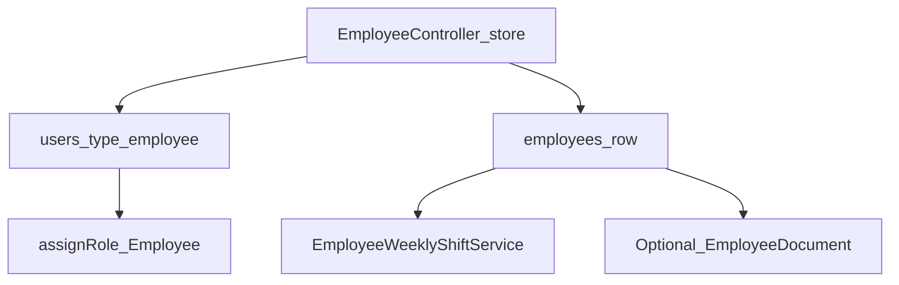

**`EmployeeController::store` (high level):**

1. Requires `create employee`; validates unique email on **`users`**; requires `branch_id`, `department_id`, `designation_id`.
2. Enforces plan `max_users` against the company plan.
3. Creates **`User`**: `type = 'employee'`, hashed password, `created_by = creatorId()`, `assignRole('Employee')`, optional email verification.
4. Creates **`Employee`**: `user_id` → that user; generates `employee_id` via company numbering; sets branch/department/designation, bank/tax/schedule fields; `created_by = creatorId()`.
5. Syncs weekly shifts; optional document uploads by document type.
6. Optional `new_user` email notification.

**Relations:** `Employee::user()`, `branch()`, `department()`, `designation()`. Departments belong to branches; UI filters departments by selected branch.

**Other hire paths:** CSV import (`EmployeesImport`); recruitment onboard convert (`JobApplicationController::jobBoardConvertData`) creates the same User + Employee pair.

### 5.6 Payroll: set salary → generate payslip → pay

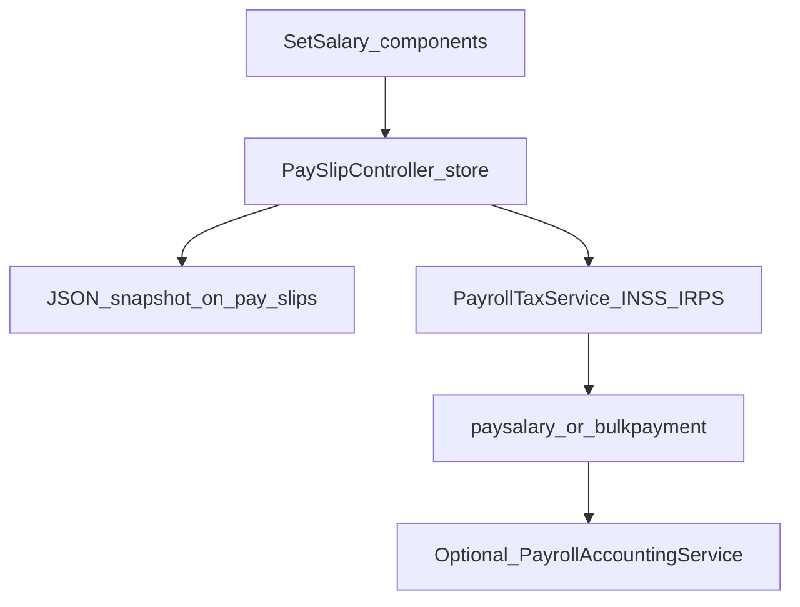

**Set salary (`SetSalaryController`):**

- Lists employees; detail screen loads per-employee component rows: allowances, commissions, loans, saturation deductions, other payments, overtimes.
- Basic salary / payslip type / bank account / `salary_chart_account_id` stored on `employees`.
- Component CRUD routes attach rows with `employee_id` (live masters).

**Generate payslips (`PaySlipController::store`):**

1. Target month → `salary_month` = `Y-m`.
2. Eligible employees: same `created_by`, date of joining ≤ month end, `salary > 0`, no existing payslip for that month, not in active resignation/termination exclusion lists.
3. Snapshot components into JSON columns via `Employee::*JsonForPayslipMonth` helpers.
4. Recalculate net (`get_net_salary`), IRPS base, then `PayrollTaxService` → INSS/IRPS → `net_payble`.
5. `EmployeeLoanScheduleService::recordRepaymentsForPayslip`.

**Mark paid:**

- Single `paysalary` or `bulkpayment` → `status = 1`.
- If settings `payroll_integration_mode === 'hrm_accounting'` **and** plan has both `hrm` and `account`: `PayrollAccountingService::postPaymentJournal` posts via `JournalEntryPoster`, stores `pay_slips.payroll_journal_id` (expense/liability/bank chart accounts from settings + employee bank).

**Important:** master allowance/deduction rows live on employee tables; payslips store **JSON snapshots**. Editing a payslip can mutate live component rows and refresh the snapshot.

### 5.7 Leave request and approval

1. **Create** (`LeaveController::store`, permission `create leave`): company/HR select `employee_id`; others use own employee record. Requested days must be ≤ `leave_types.days`. Status starts as **`Pending`**.
2. **List:** company/HR see all for tenant; employees see own leaves.
3. **Action** (`leave/{id}/action` → `changeaction`): approve maps UI `Approval` → stored **`Approved`** (recalculates days); reject → **`Reject`**. Notifications/email templates may fire (`leave_action_sent`).
4. **Balance** helper (`jsoncount`): sums leave days per type for the year (excludes rejects).

Statuses in use: `Pending`, `Approved`, `Reject`.

### 5.8 Attendance

`AttendanceEmployeeController` supports several modes:

| Mode | Behavior |
|------|----------|
| Mark Attendance CRUD | Manual present/absent + clock in/out; late/early/OT via `EmployeeAttendanceScheduleService` |
| Bulk Attendance | Branch + department → mark many employees for one date |
| Self clock-in | Logged-in employee; optional IP restrict (`IpRestrict`); schedule-based late |
| CSV import | Map email, date, clock in/out |
| Biometric | Controller exists; **resource routes often commented** in `web.php` |

Also: business-day locks on edits; weekly shifts / company defaults affect schedule calculations.

### 5.9 Recruitment pipeline

```text
Job (jobs)
  → JobApplication (stage = first JobStage)
      → kanban stageChange / archive / notes / skills
      → InterviewSchedule (candidate = application; interviewer = employee/user)
          → JobOnBoard (job_on_boards)
              → Convert → User + Employee (hire)
```

Public career pages: `job/career` with permission `show career`. Custom questions attach to jobs/applications. Onboard can generate offer-letter PDF.

### 5.10 Performance, training, HR admin

- **Performance:** indicators → appraisals; goal tracking against goal types; competencies / performance types as setup masters.
- **Training:** training records, trainers, training types; often branch/department filtered.
- **HR admin:** awards, transfers, resignations, trips (`Travel`), promotions, complaints, warnings, terminations, announcements, holidays — standard CRUD scoped by `created_by`, with type masters where applicable.
- **Events / meetings:** calendar-style records with employee pivot tables.
- **Assets / documents / policy:** employee assets (`account-assets`), uploads (`document-upload` / `DucumentUpload`), company policies.

### 5.11 Permissions (naming patterns)

Spatie permissions use **spaces**, not snake_case. Common patterns:

| Pattern | Examples |
|---------|----------|
| `manage {resource}` | `manage employee`, `manage leave`, `manage pay slip`, `manage job application` |
| `create` / `edit` / `delete` / `show` | `create employee`, `edit leave`, `show appraisal` |
| Multi-word | `manage set salary`, `manage job onBoard`, `manage goal tracking` |
| Dashboard / reports | `show hrm dashboard`, `manage report` |
| Setup masters | `manage leave type`, `manage payslip type`, `manage allowance option`, `manage job stage` |

Company/HR roles get large HRM bundles; Employee role gets a smaller self-service subset. Watch case anomalies (e.g. seeded `Manage Competencies` vs menu `manage competencies`).

### 5.12 Integrations

| Integration | Detail |
|-------------|--------|
| Branch | FK on employees; filters attendance, jobs, training, reports |
| Accounting | Opt-in `payroll_integration_mode = hrm_accounting`; needs chart accounts + plan `account` |
| Tax / compliance | INSS/IRPS on payslips; `report.hrm.tax`; IRPS Modelo 22 also under Accounting monthly reports |
| Reports | Payroll, leave, monthly attendance reports + HRM dashboard |
| Notifications | Email templates; optional Slack/Telegram/webhooks on payslip create |
| Google Calendar | Optional sync when creating interview schedules |
| Plan limits | `max_users` enforced on employee create |

### 5.13 Gotchas

1. **User `type` casing** — created as `'employee'` lowercase; many checks compare `'Employee'` — inconsistent.
2. **Payslip JSON vs live rows** — regenerating overwrites from current components; editing payslip can mutate masters.
3. **Payslip requires `salary > 0`** — employees without basic salary are skipped on generate.
4. **Document typo** — `DucumentUpload` / `ducument_uploads` spelling is intentional in code.
5. **Biometric routes** may be disabled in `web.php` even though controller exists.
6. **Clock-in `created_by`** sometimes stored as `Auth::id()` instead of `creatorId()` — be careful in queries/reports.
7. **Setup masters** are easy to miss — use `hrm_setup` layout tabs, not only the main HRM System menu.
8. **Some permission / Gate string mismatches** (capitalization) can hide menu items or block actions unexpectedly.
9. **Always scope by `creatorId()`** when adding HRM features.

---

## 6. CRM

**Plan flag:** `plans.crm == 1`  
**Canonical menu:** `resources/views/partials/admin/menu.blade.php` (CRM dashboard + **CRM System**)  
**Setup tabs:** `resources/views/layouts/crm_setup.blade.php`  
**Routes:** `routes/web.php` (deals ~1389–1444, leads ~1459–1508, form builder ~1932–1951, contracts ~1953–1994; public forms ~758–759)

### 6.1 Purpose and who uses it

CRM covers sales pipeline work: leads, deals, web form capture, and contracts. Setup masters define pipelines, lead stages, deal stages, sources, labels, and contract types.

Typical roles: company admin, sales staff (assignees on `user_leads` / `user_deals`), and **clients** (limited menu: Deals + Contracts).

When the plan enables CRM, the sidebar exposes:

1. **CRM** (dashboard + lead/deal reports) — needs `show crm dashboard` / report permissions  
2. **CRM System** — Leads, Deals, Form Builder, Contract, CRM System Setup (pipelines)

### 6.2 Folder map

| Area | Controllers | Models | Views |
|------|-------------|--------|-------|
| Setup | `PipelineController`, `LeadStageController`, `StageController`, `SourceController`, `LabelController`, `ContractTypeController` | `Pipeline`, `LeadStage`, `Stage`, `Source`, `Label`, `ContractType` | `pipelines/`, `lead_stages/`, `stages/`, `sources/`, `labels/`, `contractType/` |
| Leads | `LeadController` | `Lead`, `UserLead`, `LeadFile`, `LeadDiscussion`, `LeadActivityLog`, `LeadCall`, `LeadEmail` | `leads/` |
| Deals | `DealController` | `Deal`, `UserDeal`, `ClientDeal`, `DealTask`, `DealFile`, `DealDiscussion`, `DealCall`, `DealEmail`, `ActivityLog` | `deals/` |
| Form builder | `FormBuilderController` | `FormBuilder`, `FormField`, `FormFieldResponse`, `FormResponse` | `form_builder/` |
| Contracts | `ContractController` | `Contract`, `Contract_attachment`, `ContractComment`, `ContractNotes` | `contract/` |
| Dashboard / reports | `DashboardController::crm_dashboard_index`, `ReportController` lead/deal reports | — | `dashboard/crm-dashboard.blade.php`, `report/` |

### 6.3 Key tables

| Table | Purpose |
|-------|---------|
| `pipelines` | Shared pipeline for both lead and deal boards |
| `lead_stages` | Kanban columns for leads (`pipeline_id`) |
| `stages` | Kanban columns for deals (`pipeline_id`) — **different table** from lead stages |
| `sources`, `labels` | Taxonomy |
| `leads`, `user_leads` | Lead records + assignee pivot |
| `lead_files`, `lead_discussions`, `lead_activity_logs`, `lead_calls`, `lead_emails` | Lead activity |
| `deals`, `user_deals`, `client_deals` | Deal + staff + client pivots |
| `deal_tasks`, `deal_files`, `deal_discussions`, `deal_calls`, `deal_emails` | Deal activity |
| `form_builders`, `form_fields`, `form_field_responses`, `form_responses` | Public forms |
| `contracts`, `contract_types`, `contract_attachment`, `contract_comment`, `contract_notes` | Contracts |

**CSV associations (not pivots):** on leads/deals, `sources`, `products`, and `labels` are often stored as **comma-separated id strings** pointing at `sources` / `ProductService` / `labels`.

Tenant scope: company users typically filter by `created_by`; staff often see records through `user_leads` / `user_deals`. Deals sometimes use `ownerId()` — see gotchas.

### 6.4 Menu and setup

| CRM System item | Permission | Route |
|-----------------|------------|--------|
| Leads | `manage lead` | `leads.index` |
| Deals | `manage deal` | `deals.index` |
| Form Builder | `manage form builder` | `form_builder.index` |
| Contract | `manage contract` | `contract.index` |
| CRM System Setup | setup perms (pipeline/stage/source/label/contract type) | `pipelines.index` |

**Setup sidenav** (`crm_setup`): Pipeline → Lead Stages → Deal Stages → Sources → Labels → Contract Type.

**Client menu:** Deals + Contract only (no Leads / Form Builder / Setup).

### 6.5 Lead lifecycle

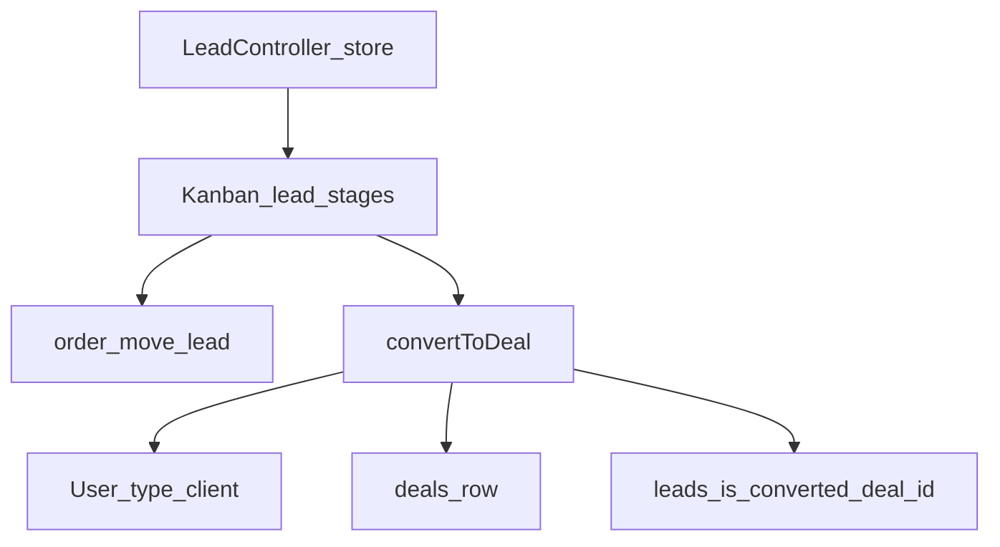

| Step | Method | Behavior |
|------|--------|----------|
| Create | `store()` | Needs subject/name/email; pipeline = user `default_pipeline` or first; stage = first `LeadStage`; writes `user_leads`; email `lead_assigned` |
| Move stage | `order()` | Needs `move lead`; updates `stage_id` + `order`; `LeadActivityLog`; email `Move Lead` |
| Convert UI | `showConvertToDeal` | View `leads.convert` |
| Convert | `convertToDeal` | Create/link client; create deal on first **deal** `Stage` for same pipeline; optional copy of sources/products/notes/files/calls/emails; `ClientDeal` + `UserDeal`; set `leads.is_converted = deal.id` |

Lead row is **not deleted** after conversion. Convert permission is enforced in Blade (`@can('convert lead to deal')`) more than in the controller — treat as a security review item when changing this flow.

**Prerequisite:** pipeline must have lead stages before creating leads; convert also needs deal stages on that pipeline (“Please Create Stage for This Pipeline.”).

### 6.6 Deal lifecycle

| Concern | Behavior |
|---------|----------|
| Create | `store()` — clients required; first deal `Stage` on default pipeline; `ClientDeal` + `UserDeal`; status `Active`; email `deal_assigned` |
| Default pipeline | `changePipeline()` updates `users.default_pipeline` |
| Move stage | `order()` — `move deal`; activity log + email `Move Deal` |
| Status | `changeStatus` — `Active` / `Won` / `Loss` (`Deal::$statues`) |
| Users / clients | CRUD on pivots; per-client deal permissions (`Deal::$permissions`) |
| Products / sources / labels | Edit helpers; products → `ProductService` via CSV ids |
| Tasks | `DealTask` on `deal_tasks`; permissions `create/edit/delete/view task` |
| Calls / emails / files / notes / discussions | Dedicated controller actions |
| Import / export | Excel/CSV import-export paths on `DealController` |

Clients see deals through `client_deals`.

### 6.7 Form builder → public form → lead

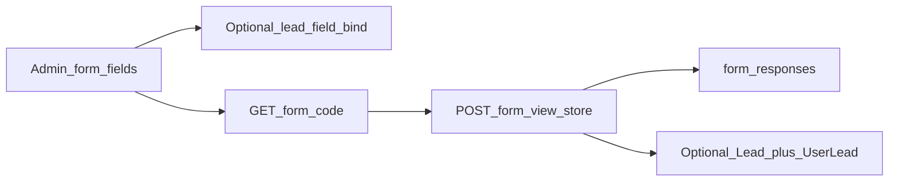

1. Admin creates `form_builders` with unique `code`, `is_active`, plus `form_fields`.
2. Optional bind (`formFieldBind` / `bindStore`): `is_lead_active` + map fields to name/email/subject/phone, `user_id`, `pipeline_id` (stored in `form_field_responses` mapping).
3. Public (no auth): `GET /form/{code}` → `formView`; `POST /form_view_store` → `formViewStore`.
4. Always writes `FormResponse` (JSON payload).
5. If `is_lead_active == 1`: may reject if email already exists in `users`; creates `Lead` on first stage of bound pipeline + `UserLead` for form owner / assignee.

### 6.8 Contracts

1. Resource CRUD on `ContractController`; type from `contract_types`; `client_name` = client user id; optional `project_id`.
2. Status flow: default often `pending`; accept/decline via status helpers; company/client signatures (`signature` / `signatureStore`).
3. Attachments, comments, notes, copy, PDF/template, email (`new_contract` / `sendmailContract`).
4. Optional Slack / Telegram / webhook “New Contract”.

### 6.9 Permissions (patterns)

| Area | Examples |
|------|----------|
| Dashboard | `show crm dashboard` |
| Lead | `manage/create/view/edit/delete lead`, `move lead`, `convert lead to deal`, lead call/email perms |
| Deal | `manage/create/edit/view/delete deal`, `move deal`, deal call/email |
| Stages / pipeline | `manage pipeline`, `manage lead stage`, `manage stage` |
| Taxonomy | `manage source`, `manage label` |
| Tasks | `view/create/edit/delete task` |
| Form | `manage form builder`, `manage form field`, `view form response` |
| Contract | `manage/create/edit/delete/show contract`, `manage contract type` |

Role CRM modules (role UI) group: lead, pipeline, lead stage, source, label, deal, stage, task, form builder, contract, etc.

### 6.10 Integrations

| Integration | How |
|-------------|-----|
| Users | Assignees via `user_leads` / `user_deals` |
| Clients | `users.type = client`; `client_deals`; contracts; convert-from-lead creates client |
| Products | `ProductService` ids on leads/deals (CSV) |
| Projects | Contracts optional `project_id` |
| Invoices | `Deal::invoices()` via `invoices.deal_id` when used |
| Email templates | `lead_assigned`, `Move Lead`, `Assign Deal`, `deal_assigned`, `Move Deal`, `Create Task`, `New User`, `new_contract` |
| Reports / dashboard | `/reports-lead`, `/reports-deal`, CRM dashboard totals by stage |
| Custom fields | Deal create can use `CustomField` module `deal` |
| Slack / Telegram / webhooks | Lead→deal conversion, new contract |

### 6.11 Gotchas

1. **Shared pipeline, two stage tables** — `lead_stages` ≠ `stages`; both needed for lead→deal convert on the same pipeline.
2. **`creatorId()` vs `ownerId()`** — leads lean on `creatorId()`, deals often on `ownerId()`; inconsistent scoping risk.
3. **Convert permission** mainly Blade-gated — add server-side `can('convert lead to deal')` when hardening.
4. **CSV associations** — products/sources/labels as comma strings; empty/`0` fragments are common bugs.
5. **Form lead conversion** checks email uniqueness against `users`, not `leads`; fails quietly if pipeline has no lead stage.
6. **Static cache bugs** — some `LeadController` / `DealController` helpers use static `$leadData` / `$dealData`; kanban reorder can update the wrong record.
7. **Route typo risk** — form field bind route historically had an extra `}` in `web.php` (`form_field_store/{id}}`) — verify when debugging bind failures.
8. **Activity CRM UI** — permission `view CRM activity` may exist without a live route/view.
9. **Always create stages before using boards** — empty pipelines block lead/deal create and convert.

---

## 7. Projects

**Plan flag:** `plans.project == 1`  
**Canonical menu:** `resources/views/partials/admin/menu.blade.php` (**Project System** ≈1251–1342; Project dashboard ≈407+)  
**Routes:** `routes/web.php` (projects/tasks/timesheets/bugs/tracker/reports roughly ~1663–1890 and related); tracker API in `routes/api.php`

### 7.1 Purpose and who uses it

Project System manages delivery work: projects, kanban tasks, timesheets, desktop/web time tracking, bug reports, milestones, Gantt/calendar, project expenses, and project reports.

Typical roles: company admin, employees/staff assigned via `project_users`, and **clients** (`users.type = client` linked by `projects.client_id` — clients menu under User Management, not Project System).

### 7.2 Folder map

| Area | Controllers | Models | Views |
|------|-------------|--------|-------|
| Projects | `ProjectController` | `Project`, `ProjectUser`, `Milestone`, `ActivityLog` | `projects/` |
| Tasks / boards | `ProjectTaskController`, `TaskStageController` | `ProjectTask`, `TaskStage`, `TaskComment`, `TaskChecklist`, `TaskFile` | `project_task/`, `tasks/calendar*` |
| Timesheets | `TimesheetController` | `Timesheet` | `projects/timesheets/`, `projects/timesheet_list.blade.php` |
| Time tracker | `TimeTrackerController`, `ApiController` (start/stop/photos), parts of `ProjectController` / `DashboardController` | `TimeTracker`, `TrackPhoto` | `time_trackers/` |
| Bugs | Bug CRUD/kanban on `ProjectController`; global list on `ProjectTaskController`; `BugStatusController` | `Bug`, `BugStatus`, `BugComment`, `BugFile` | `projects/bug*`, `bugstatus/` |
| Expenses | `ProjectExpenseController` | `ProjectExpense` | `project_expense/` |
| Reports | `ProjectReportController` | Reads `Project` / `ProjectTask` / stages | `project_report/` |
| Clients (linked) | `ClientController` | Client = `User` type `client` | client views under user management |
| Legacy stages | `ProjectstagesController` | `Projectstages` (+ old `Task`) | `projectstages/` — not the live Project System setup |

### 7.3 Key tables

| Table | Purpose |
|-------|---------|
| `projects` | Project header; `client_id`, budget, status, `copylinksetting` JSON, `created_by` |
| `project_users` | Staff membership (`project_id`, `user_id`, `invited_by`) — **no per-member ACL columns** |
| `milestones`, `activity_logs` | Milestones and activity |
| `task_stages` | Kanban columns (tenant-wide in practice via `created_by`) |
| `project_tasks` | Tasks; `stage_id`, CSV `assign_to`, priority, complete flags |
| `task_comments`, `task_checklists`, `task_files` | Task collaboration |
| `timesheets` | Manual time entries (project/task/day, `HH:MM`) |
| `time_trackers`, `track_photos` | Live tracker sessions + screenshots |
| `bugs`, `bug_statuses`, `bug_comments`, `bug_files` | Bug tracking |
| `project_expenses` | Project-only expenses (not accounting `expenses`) |

### 7.4 Menu (Project System)

| Item | Gate | Route |
|------|------|--------|
| Projects | `manage project` | `projects.index` |
| Tasks | `manage project task` | `taskBoard.view` |
| Timesheet | `manage timesheet` | `timesheet.list` |
| Bug | `manage bug report` | `bugs.view` |
| Task Calendar | `manage project task` | `task.calendar` |
| Tracker | `type != 'super admin'` (no Spatie gate) | `time.tracker` |
| Project Report | company or Employee type | `project_report.index` |
| Setup → Task Stages | `manage project task stage` | `project-task-stages.index` |
| Setup → Bug Status | `manage bug status` | `bugstatus.index` |

Project expenses, Gantt, and per-project bugs/timesheets live mainly on the **project show toolbar** (`projects/view.blade.php`), not as top-level Project menu roots. Clients are under **User Management**.

### 7.5 Main flow: create project

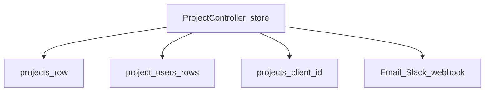

**`ProjectController::store` (high level):**

1. Requires `create project`.
2. Form fields: name, dates, **required** image, optional client, **required** user(s), budget, estimated hours, description, tags, status (`in_progress` / `on_hold` / `complete` / `canceled`).
3. Saves `projects` with `created_by = creatorId()`, `client_id` or `0`, default `copylinksetting` JSON.
4. Inserts `project_users`: company path adds creator + selected users; other paths also include current user / creatorId as needed.
5. Client is **not** added to `project_users` — client access is via `projects.client_id`.
6. Later invite/remove: `inviteProjectUserMember`, `destroyProjectUser`.
7. Notifications: `new_project` email; optional Slack/Telegram/webhook.

Spatie permissions are **global** (not stored per project member on the pivot).

### 7.6 Task board flow

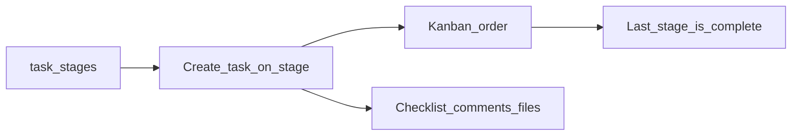

- **Per-project board:** `GET /projects/{id}/task` → stages ordered by `order`, tasks by `stage_id`.
- **Global Tasks menu:** list/grid across the user’s projects.
- **Create:** name, estimated hours, priority, dates, milestone, `assign_to` (CSV of member ids from UI), `stage_id`.
- **Move:** `taskOrderUpdate` — reorder + change stage; moving to **last** stage sets `is_complete = 1` / `marked_at`; leaving last stage clears complete. Also: `changeCom`, `changeProg`, `changeFav`.
- **Collaboration:** checklists → `task_checklists`; comments → `task_comments`; files → `task_files` (`uploads/tasks/`).
- **Priorities:** critical / high / medium / low (+ color).
- Optional Google Calendar sync when company setting `synchronize_type = google_calender`.

### 7.7 Timesheet vs time tracker

| Feature | Timesheet | Time tracker |
|---------|-----------|--------------|
| Purpose | Manual logged hours | Live start/stop sessions (+ screenshots) |
| UI | `timesheet.list`, per-project timesheet | `time.tracker` |
| Storage | `timesheets` (`time` as `HH:MM`, project/task/day) | `time_trackers`, `track_photos` |
| API | — | Sanctum: `get-projects`, `add-tracker` (start/stop), `upload-photos` |
| Auto-sync | — | **Does not** write into `timesheets` |

Tracker list: company sees all for `created_by`; others see own `user_id`. Settings: `tracker.settings`.

### 7.8 Bugs

- Per project: list/kanban (`task.bug`, `task.bug.kanban`); global: `bugs.view`.
- Fields: title, priority, status → `bug_statuses`, assignee (project members), dates, description; sequential `bug_id` via `User::bugNumberFormat`.
- Comments/files on `bug_comments` / `bug_files`.
- Kanban drag needs `move bug report`. Status masters: `bugstatus` resource.

### 7.9 Project expenses and reports

- **Expenses:** CRUD under a project; optional `task_id` and attachment; compared to `project.budget` in UI.
- **No accounting bridge** — isolated `project_expenses` (not chart-of-accounts / bill expense).
- Permission naming risk: some checks use `edit expense` vs `edit project expense`.
- **Reports:** `ProjectReportController` aggregates projects/tasks/stages/members for company/Employee users.

### 7.10 Permissions (patterns)

| Area | Examples |
|------|----------|
| Dashboard | `show project dashboard` |
| Project | `manage/create/view/edit/delete project`, `share project` |
| Milestone | `create/edit/delete/view milestone` |
| Gantt | `view grant chart` (**typo:** “grant” not “gantt”) |
| Task | `manage/create/edit/view/delete project task` |
| Task stage | `manage/create/edit/delete project task stage` |
| Timesheet | `view/manage/create/edit/delete timesheet` |
| Expense | `manage/create/edit/delete project expense` |
| Bug | `manage/create/edit/delete/move bug report`, `manage bug status` |
| Activity | `view activity` |

Clients: `manage client` under User Management.

### 7.11 Integrations

| Integration | How |
|-------------|-----|
| Clients | `projects.client_id` → `User` type client |
| CRM contracts | `contracts.project_id`; helpers like `clientByProject` / `project.by.user.id` |
| Invoices | No solid `project_id` usage found on invoice flows |
| Gantt | `projects.gantt` / `ganttPost`; drag updates task dates |
| Task calendar | `task.calendar` + drag; optional Google Calendar |
| Copy / share link | `projects.copylink` / `projects.link` + `copylinksetting` toggles |
| Notifications | Email, Slack, Telegram, webhooks for project/task/comment |
| Desktop tracker | Sanctum API in `routes/api.php` |

### 7.12 Gotchas

1. **Task stages are tenant-global** in practice — not per-project boards, despite a `project_id` column existing.
2. **Dual stage systems** — live `TaskStage` vs legacy `Projectstages` + `Task`.
3. **Clients are not `project_users`** — portal access is by `client_id`.
4. **Tracker ≠ timesheet** — no automatic transfer between them.
5. **Project expenses ≠ accounting expenses**.
6. **Some registered routes lack controller methods** (e.g. user-permission / remove-user / API `stop-tracker` naming) — can 500 if hit; verify before relying on them.
7. **`User::checkProject` may be unreliable** (historically always returned Owner-like results).
8. **`assign_to` is CSV + `FIND_IN_SET`** — multi-assignee depends on JS filling the hidden field.
9. **Gantt permission typo:** `view grant chart`.
10. **Tracker / Project Report menus** are partly gated by user `type`, not only Spatie permissions.

---

## 8. Inventory / products

**Plan flags:** menu shows when `plans.stock == 1` **OR** `plans.pos == 1`  
**Also needs:** `manage warehouse` **OR** `manage product & service`  
**Canonical menu:** Products System in `resources/views/partials/admin/menu.blade.php` (~1390–1438)  
**Category/Unit setup:** Accounting Setup (`resources/views/layouts/account_setup.blade.php`) — not under Products System

### 8.1 Purpose and who uses it

Products System is the inventory catalog and warehouse layer: products/services/kits/ingredients, warehouse bins, transfers, losses, manual stock-in, and batch/lot monitoring. It feeds Accounting (COA/tax on products), Purchases (stock-in), Sales/Invoices (deduction timing), POS, and Hotel minibar-style deductions.

Typical roles: company admin, warehouse staff, purchasing, POS operators (consume stock).

### 8.2 Folder map

| Area | Controllers | Models | Views |
|------|-------------|--------|-------|
| Catalog | `ProductServiceController` | `ProductService`, `ProductKitItem`, `ProductRecipe`, `ProductVariant`, `ProductOptionItem`, `ProductIdentifier` | `productservice/` |
| Categories / units | `ProductServiceCategoryController`, `ProductServiceUnitController` | `ProductServiceCategory`, `ProductServiceUnit` | `productServiceCategory/`, `productServiceUnit/` |
| Warehouses | `WarehouseController` | `warehouse`, `WarehouseProduct`, `WarehouseDocument` | `warehouse/` |
| Transfers | `WarehouseTransferController` | `WarehouseTransfer` | `warehouse-transfer/` |
| Loss | `WarehouseLossController` | `WarehouseLoss` | `warehouse-loss/` |
| Manual stock | `ProductStockController` | Uses `ProductService` / `WarehouseProduct` / lots (no dedicated ProductStock model) | `productstock/` |
| Batch monitor | `ProductBatchMonitorController` | `ProductExpiryLot` | `productbatch/` |

**Key services / helpers:**

| Piece | Role |
|-------|------|
| `InvoiceSaleDeductionService` | Invoice/delivery-note stock out (aggregate qty) |
| `BatchLotDeductionService` | FEFO/FIFO/LIFO lot consumption (POS alias `PosFefoDeductionService`) |
| `PosKitDeductionService` / `PosRecipeDeductionService` | Kit / recipe BOM deduct on POS |
| `ProductOptionService` | Option/add-on deduct |
| `HotelStockDeductionService` | Hotel module stock out |
| `Utility` | `total_quantity`, `warehouse_quantity`, `warehouse_transfer_qty`, `addProductStock`, `addWarehouseStock` |
| `SendStockAlerts` command | Low/max stock threshold alerts |

### 8.3 Key tables

| Table | Purpose |
|-------|---------|
| `product_services` | Catalog; type, prices, tax CSV, COA ids, qty, thresholds, `batch_tracking`, `affect_stock`, … |
| `product_kit_items`, `product_recipes`, `product_variants`, `product_option_items`, `product_identifiers` | Kits, BOM, variants, options, serial/MAC |
| `product_service_categories`, `product_service_units` | Taxonomy |
| `warehouses`, `warehouse_products`, `warehouse_documents` | Warehouses and per-warehouse qty (optional `product_variant_id`) |
| `warehouse_transfers`, `warehouse_losses` | Transfer batches / write-offs |
| `product_expiry_lots` | Batch/lot with expiry, warehouse, remaining qty |
| `stock_reports` | Stock movement ledger |
| `users.warehouse_id` | Optional default warehouse restriction for staff |

### 8.4 Menu (Products System)

| Item | Route | Permission |
|------|--------|------------|
| Warehouse | `warehouse.index` | `manage warehouse` |
| Transfer | `warehouse-transfer.index` | `manage warehouse` |
| Warehouse Loss | `warehouse-loss.index` | `manage warehouse` |
| Product & Services | `productservice.index` | `manage product & service` |
| Product Stock | `productstock.index` | `manage product & service` |
| Batch / Lot monitor | `product-batches.index` | `manage product & service` |

Related elsewhere: Category/Unit (Accounting Setup); product/warehouse reports under Reports; POS Production / low stock under POS when `pos == 1`.

### 8.5 Product create flow

**Controller:** `ProductServiceController::store`  
**Permission:** `create product & service`

**Types** (`product` | `service` | `kit` | `ingredient`):

| Type | Stock behavior |
|------|----------------|
| `product` | Stockable; variants/options/recipes; `affect_stock` unless opted out |
| `service` | Non-stock path |
| `kit` | `affect_stock = false`; components in `product_kit_items` (components are type `product`) |
| `ingredient` | Stock/recipes; not on POS; batch tracking allowed |

**Required:** `name`, `sku`, `sale_price`, `purchase_price`, `category_id`, `unit_id`, `type`.

**Chart accounts:** income COA → `sale_chartaccount_id`; expense/CMV COA → `expense_chartaccount_id` (seeded COA names often Portuguese, e.g. Rendimento / Despesas / CMV).

**Tax:** multi-select stored as comma-separated ids on `tax_id`.

**Initial stock:** create sets `quantity = 0` — **no warehouse rows**. Stock enters via Product Stock, Purchase, or other inbound paths.

Also configurable: image, price levels, POS print zone/printer, low/max thresholds, identifier tracking, batch method (FEFO/FIFO/LIFO), expiry alert days, kits/variants/options/recipes.

### 8.6 Warehouse transfer and loss

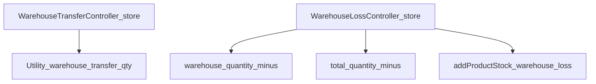

**Transfer:**

1. Needs `create warehouse`; from ≠ to; qty ≤ source `warehouse_products`.
2. Multi-line items share `transfer_batch_id` UUID.
3. `Utility::warehouse_transfer_qty` moves warehouse qty (creates destination row if needed).
4. Staff with `users.warehouse_id` may be restricted via `allowedWarehouseIds()`.
5. **Does not** move `product_expiry_lots` or change aggregate `product_services.quantity`.

**Loss:**

1. Warehouse + product (`product`|`kit`) + qty + issuer/authorized/witness; generates `WO-######`.
2. Decrements warehouse + aggregate qty; writes `stock_reports` via `addProductStock(..., 'warehouse_loss', ...)`.
3. **Does not** consume batch lots.

### 8.7 Stock deduction timing (invoice / POS / purchase)

**Company setting:** `stock_deduction_timing` = `invoice` (default) or `delivery_note` (settings UI: company settings).

| Channel | Behavior |
|---------|----------|
| **Invoice** | If timing = `invoice`: `InvoiceSaleDeductionService::deductLine` on create/release path; stamps `stock_deducted_at` / `stock_deducted_via`. If `delivery_note`: deduct when delivery note is created. Updates **aggregate** `product_services.quantity` + `stock_reports` type `invoice` — **not** `warehouse_products` (invoices have no warehouse_id). Order: options → identifiers → kit → lots → simple product if `affect_stock`. |
| **POS** | Immediate warehouse-aware deduct (no timing setting): options → kit → variant/recipe → batch lots → recipe/product + warehouse. |
| **Purchase** | Immediate stock-in: lots (`source = purchase`), identifiers, `total_quantity('plus')`, `addWarehouseStock`. |
| **Hotel** | `HotelStockDeductionService` — warehouse + lots + ledger type `hotel`. |

### 8.8 Batch / lot / thresholds

| Feature | Where |
|---------|--------|
| `batch_tracking` + method `fefo`/`fifo`/`lifo` | `product_services` |
| Lots | `product_expiry_lots` (batch_no, mfg/expiry, qty in/remaining, warehouse, source) |
| Monitor | `product-batches` UI |
| Expiry alerts | `expiry_alert_days` + dashboard queries |
| Low stock | per-product `low_stock_threshold`; global `pos_low_stock_threshold` |
| Max stock | per-product `max_stock_threshold`; global `max_stock_threshold_global`; cron `SendStockAlerts` |

### 8.9 Permissions

| Area | Names |
|------|--------|
| Catalog | `manage/create/edit/delete product & service` |
| Warehouse | `manage/create/edit/show/delete warehouse` (transfer/loss create uses `create warehouse`) |
| Category / unit | `manage/create/edit/delete constant category`, `… constant unit` |
| Reports | `stock report` |

### 8.10 Integrations

| System | Integration |
|--------|-------------|
| Accounting | Product COA + tax; Category/Unit in Accounting Setup; invoice stock timing in company settings |
| Purchases | Primary stock-in + lots + warehouse |
| Sales / Invoice | Aggregate deduction via timing setting |
| POS | Plan `pos` unlocks Products System; sale deducts warehouse; recipes/kits/variants; ingredients hidden from POS |
| Hotel | Catalog + warehouse consumption |
| Bills / expenses | Some paths also call `Utility::addProductStock` |

### 8.11 Gotchas

1. **Invoice stock ≠ warehouse stock** — invoice/delivery-note paths update aggregate qty; POS/Hotel/Purchase update warehouse. The two can diverge.
2. **Transfer/loss ignore lots** — lot rows may remain on the old warehouse.
3. **SKU uniqueness** may be scoped to `Auth::user()->id` instead of `creatorId()` — wrong for company staff tenants.
4. **`Utility::total_quantity`** often only adjusts type `product` — ingredients/kits may not move aggregate qty that way.
5. **Create does not stock** — catalog qty starts at 0.
6. **Unit UI permissions** may incorrectly check `constant category` instead of `constant unit`.
7. **Oversell behavior differs** — Hotel/POS often floor at 0; invoice batch path may throw if lots insufficient.
8. **Plan gate** — Products System needs `stock` or `pos`; Accounting can still use Category/Unit without that menu.

---

## 9. POS

**Plan flag:** `plans.pos == 1`  
**Canonical menu:** POS dashboard + **POS System** in `resources/views/partials/admin/menu.blade.php` (~417–486, ~1443–1590)  
**Primary controller:** `app/Http/Controllers/PosController.php`  
**Routes:** `routes/web.php` (~2298–2383 POS cluster; reports ~1706–1727)

### 9.1 Purpose and who uses it

POS covers retail checkout and restaurant floor operations: cart/sales, warehouse stock-out, optional invoice/ledger posting, restaurant tables/kitchen production, shifts, EOD close, audit logs, barcodes, and branch sales targets.

Typical roles: company admin (`manage pos`), Cashier (`pos restaurant full`), Waiter, Manager, Kitchen/Bar (`manage pos production` / role seeds via `PosRestaurantRoleService`).

Also unlocks **Products System** menu when stock plan is off but POS is on (see [Section 8](#8-inventory--products)).

### 9.2 Folder map

| Area | Controllers | Models | Views |
|------|-------------|--------|-------|
| Sale screen | `PosController` | `Pos`, `PosProduct`, `PosPayment`, `PosBalance` | `pos/` (`index`, `index-restaurant`, `script`, `receipt`, …) |
| Areas / tables | `PosAreaController`, `PosTableController` | `PosArea`, `PosTable`, `PosTableAssignment` | `pos_area/`, `pos_table/` |
| Printers | `PosPrinterController` | `PosPrinter` | `pos_printer/` |
| Production | `PosProductionController`; send via `PosController::sendToProduction` | Uses `Pos` / `PosProduct` / `PosShift` | `pos_production/` |
| Shifts | `PosShiftController`; reports via `ReportController` / `PosShiftReportService` | `PosShift`, `PosCashDrop`, `PosCashIn` | `pos_shift/`, `report/pos_shift.blade.php` |
| Audit | `PosAuditLogController` | `PosAuditLog` | `pos_audit_log/` |
| Restaurant settings | `PosRestaurantSettingsController` | Settings keys in `settings` | `pos_restaurant_settings/` |
| Branch targets | `BranchSalesTargetController` | `BranchSalesTarget` | `branch_sales_targets/` |
| EOD / day | `ReportController` (EOD, close/reopen day, day summary, low stock, restaurant reports) | `PosDayClosed` | `report/pos_eod.blade.php`, … |

**Key services:** `PosActorService`, `PosToInvoiceService`, `PosPrintRoutingService`, `PosAuditLogService`, `PosShiftReportService`, `PosRestaurantRoleService`, stock helpers (`PosKitDeductionService`, `PosRecipeDeductionService`, `BatchLotDeductionService` / `PosFefoDeductionService`, `ProductOptionService`).

### 9.3 Key tables

| Table | Purpose |
|-------|---------|
| `pos`, `pos_products`, `pos_payments` | Sales header, lines, payment splits |
| `pos_areas`, `pos_tables`, `pos_table_assignments` | Restaurant floor |
| `pos_printers` | Kitchen/bar printers |
| `pos_shifts`, `pos_cash_drops`, `pos_cash_ins` | Shifts and cash movements |
| `pos_audit_logs` | Operational audit trail |
| `pos_day_closed` | Closed business days (EOD) |
| `branch_sales_targets` | Targets by branch |
| `users.pos_pin`, `users.pos_branch_id` | Terminal PIN + default POS branch |
| `stock_reports` | Ledger rows with type `pos` |

### 9.4 Menu (POS System)

| Area | Items | Typical gates |
|------|--------|----------------|
| Retail POS | POS (`pos.index`), POS Balances | `manage pos` / full / manager (balances) |
| Restaurant POS | Restaurant POS, Production, Areas, Tables, Printers, Day Summary, Audit Log, Low Stock, Restaurant Settings, Restaurant Reports | manage / full / manager / waiter / production as applicable |
| Top-level | POS Shifts, EOD Report, Branch Sales Targets, Print Barcode, Print Settings | mostly manage/full/manager; barcode `create barcode` |

Dashboard POS reports: warehouse, purchase daily/monthly, POS daily/monthly, POS vs purchase, POS by branch.

### 9.5 Main flow: retail sale

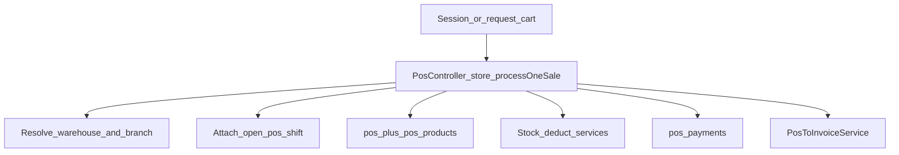

1. Retail UI uses session key `pos` (often cleared on `index()`); checkout may pass `cart` in the request.
2. `store()` / offline `sync()` → `processOneSale()`.
3. Resolve warehouse; derive `branch_id` from warehouse; attach open shift via `PosActorService::posActorId` when needed.
4. Create `pos` + `pos_products`.
5. **Stock deduct at payment:** options → kit → variant/recipe → FEFO/lots → else recipe; identifiers via invoice deduction helpers; `stock_reports` type `pos`.
6. Create `pos_payments` (cash/card/credit/mpesa/bank_transfer splits, …).
7. **Accounting:** `PosToInvoiceService::createInvoiceFromPos` → invoice `POS-{n}`, invoice products, ledger via `DocumentLedgerService` (hotel room-charge may skip unless configured).
8. Optional hotel folio charge attachment.

Also: product AJAX (`getproduct`), warehouses by branch, cart discount, receipt/barcode helpers, offline idempotent sync via `client_order_id`.

### 9.6 Restaurant flow

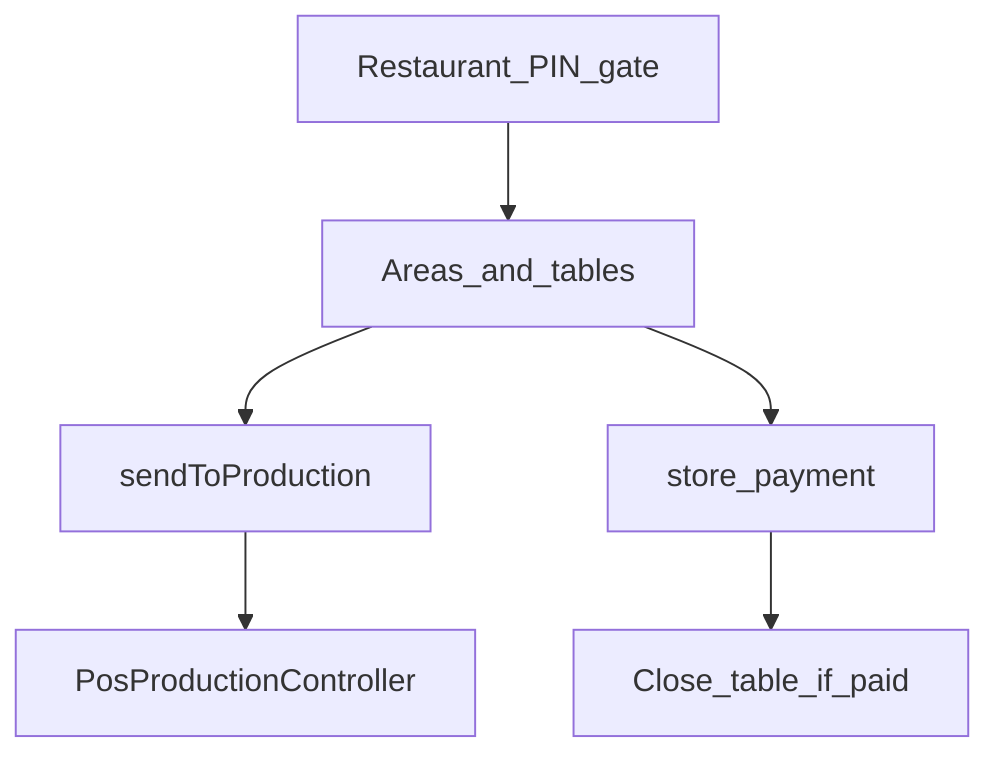

1. PIN entry (`validateRestaurantPin`) unless company login skips require-PIN (`PosActorService`).
2. Only branches with `pos_type = restaurant`; warehouses for those branches.
3. Open shift; manage tables (available/occupied/reserved); order types: dine-in, takeaway, delivery, kiosk.
4. **Send to production:** creates/updates unpaid `pos` + `pos_products` (`status=pending`, `sent_at`, print zone/printer); returns browser print jobs. **No stock deduct here.**
5. Kitchen/Bar UI filters open-shift lines by zone; statuses `in_preparation` / `ready`.
6. Pay via same `store` path (reuse unpaid order) → stock deducts; table closes when fully paid.
7. Join/move/split/void; cancel/void often need manager password (`PosAuditLogService::requireManagerPassword`).

Print routing: product/category `print_zone`, else heuristics in `PosPrintRoutingService`.

Cart session: `pos_restaurant_cart` keyed by table/shift or order type.

### 9.7 Shifts, EOD, audit

| Concern | Behavior |
|---------|----------|
| Shifts | Open/close; opening/closing balances; cash/card/credit totals; tips; operational shift; cash drop/in/out; table assign/transfer |
| EOD | `report/pos-eod`; **Close/Reopen day** typically requires `canManagePos()` **and** company owner (`creatorId() === id`); blocks if open shifts remain; writes `pos_day_closed`; may interact with `BusinessDayLockService` / hotel night audit |
| Day summary | Shifts for date with live totals for open shifts |
| Audit | open/close/reopen table, send/cancel order, discount, cash movements, close_shift, refund, void_line, switch_user |

### 9.8 Branch scoping and PIN login

**Branch:**

- `users.pos_branch_id` (+ optional `branch_user` pivot)
- `User::filterBranchIdsForPosAccess` / `canAccessBranchForPos($id, 'retail'|'restaurant')`
- Retail pool: `pos_type` retail or null; restaurant: `pos_type = restaurant`
- Sale `branch_id` comes from selected warehouse’s branch

**Login / PIN:**

| Mechanism | Detail |
|-----------|--------|
| ERP POS login | `POST /login/pos` → `storePosLogin` (email + `pos_pin`); plan must have POS; establishes PIN actor |
| Restaurant terminal PIN | Authenticated user enters PIN → maps to company user `pos_pin`; session `pos_pin_user_id` |
| Switch user | Clears cart/PIN; may require PIN again |

### 9.9 Permissions and `max_pos_users`

| Permission / role | Role |
|-------------------|------|
| `manage pos`, `show pos dashboard`, `show pos` | Core POS admin |
| `create barcode`, `give pos credit` | Barcode / credit sales |
| `manage pos production` | Kitchen production |
| `pos restaurant full` / `waiter` / `manager` | Restaurant roles (Cashier often maps to **full**) |
| `canManagePos()` | manage \| full \| waiter \| manager — **not** production-only |

**Plan limit:** `plans.max_pos_users` (`-1` = unlimited), checked on POS entry.  
**Counting gotcha:** `Plan::countPosUsersForCompany` historically counts users with **`manage pos` only**, so waiter/manager-only staff may be undercounted toward the limit.

### 9.10 Integrations

| Module | How |
|--------|-----|
| Inventory | Warehouse stock via kit/recipe/lots/options; `stock_reports`; Products System unlocked by POS plan |
| Accounting | `PosToInvoiceService` → invoice + ledger; pay customer balances from POS |
| Hotel | Charge to folio (`source_pos_id`); optional skip invoice when charging to room; night audit POS totals |

### 9.11 Gotchas

1. **Restaurant stock deducts at payment**, not when sent to kitchen — open tickets don’t reduce stock until paid.
2. **`max_pos_users` undercounts** restaurant-only staff without `manage pos`.
3. **Retail vs restaurant branch pools** are separate (`pos_type`); wrong assignment yields empty branch lists.
4. **Close day** is often company-owner-only, not every manager.
5. Offline sync needs unique `client_order_id` for idempotency.
6. Credit needs `give pos credit` or `manage pos`.
7. Cashier permission name mismatches (`pos restaurant cashier` vs role’s `pos restaurant full`) can confuse pay-button gates.
8. Production-only users may see Production menu but fail general `canManagePos()` APIs.
9. Hotel charge-to-room may skip invoice unless tenant setting enables it.
10. Legacy “POS Balances” opening/closing methods may still exist while UI lists **shifts**.

---

## 10. Users, RBAC, and settings

**Canonical menu:** User Management, Expense Management, Notification Template, Settings (company); Companies / Email Template / Void Audit Log / Settings (super admin) in `resources/views/partials/admin/menu.blade.php`  
**Primary controllers:** `UserController`, `RoleController`, `PermissionController`, `ClientController`, `SystemController`  
**Cross-ref:** tenancy / plans / auth basics in [Section 3](#3-tenancy-plans-and-auth); SaaS plans/orders detailed in [Section 11](#11-saas-billing-and-payments)

### 10.1 Purpose and who uses it

This area covers tenant staff and clients, Spatie roles/permissions, company vs platform settings, email/notification templates, standalone expense management, void audit logs, and IP restriction.

| Audience | What they see |
|----------|----------------|
| Company / staff | User Management (User, Role, Client), Expense Management, Notification Template, company Settings (+ subscription/referral/order links) |
| Super admin | Companies (same `users` resource filtered to `type=company`), platform Settings, Email Template, Email Logs, Void Audit Log, SaaS billing menus |

### 10.2 Folder map

| Area | Controllers | Models / storage | Views |
|------|-------------|------------------|-------|
| Users / companies | `UserController` | `User`, `LoginDetail`; services `CompanyUserRoleService`, `PosRestaurantRoleService` | `user/` |
| Roles / permissions | `RoleController`, `PermissionController` | Spatie `Role`, `Permission` | `role/`, `permission/` (+ `role/partials/hotel_permissions.blade.php`) |
| Clients | `ClientController` | `User` with `type=client` | `clients/` |
| Expense Management | `ExpenseCategoryController`, `ExpenseRecordController` | `ExpenseCategory`, `Expense` | `expenseCategory/`, `expenses/` |
| Settings | `SystemController` | `settings` table via `Utility::settings()`; `IpRestrict` | `settings/` (`index` = platform, `company` = tenant) |
| Email templates | `EmailTemplateController` | `EmailTemplate`, `EmailTemplateLang`, `UserEmailTemplate` | `email_templates/` |
| Notification templates | `NotificationTemplatesController` | `NotificationTemplates`, `NotificationTemplateLangs` | `notification_templates/` |
| Void audit | `DocumentVoidLogController` | `DocumentVoidLog` | `document_void_logs/` |
| Restrict IP | `SystemController` IP CRUD | `IpRestrict`; setting `ip_restrict` | `restrict_ip/` + company settings section |

### 10.3 Key tables

| Table | Purpose |
|-------|---------|
| `users` | All identities (super admin, company, staff, client) |
| `company_user` | Multi-company membership (`role`, `status`, `is_default`) |
| `branch_user` | Branch access; with `users.pos_branch_id` / `pos_pin` for POS |
| Spatie tables | `roles`, `permissions`, `role_has_permissions`, `model_has_roles`, `model_has_permissions` |
| `login_details` | User login log UI |
| `settings` | Key/value settings scoped by `created_by` |
| `expense_categories`, `expenses` | Standalone Expense Management |
| `email_templates`, `email_template_langs`, `user_email_templates` | Email templates |
| `notification_templates`, `notification_template_langs` | In-app/notification templates |
| `document_void_logs` | Void audit (`invoice`, `bill`, `pos`, `pos_line`) |
| `ip_restricts` | Allowed IPs for attendance when `ip_restrict` is on |

### 10.4 Menu map

**User Management** (non–super admin; needs `manage user` | `manage role` | `manage client`):

| Item | Permission | Route |
|------|------------|--------|
| User | `manage user` | `users.index` |
| Role | `manage role` | `roles.index` |
| Client | `manage client` | `clients.index` |

Permissions CRUD exists in routes but has **no sidebar item**. User logs open from a button on `user/index` (`user.userlog`), not a submenu.

**Expense Management:** `expense-category.index`, `expenses.index` — distinct from Accounting Purchases → Expense.

**Company Settings block:** System Settings (`settings` → `companyIndex`), Setup Subscription Plan, Referral Program, Order.

**Super admin:** Companies, SaaS billing menus, Email Template, Email Logs, Void Audit Log, platform Settings (`systems.index`).

### 10.5 User create flow

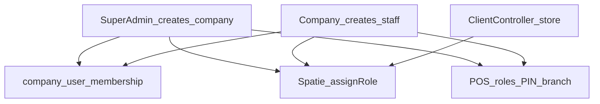

**Super admin → company tenant (`UserController::store`):**

1. Creates `users` with `type = company`, default first plan, referral code.
2. `syncCompanyMembership` for self; `assignRole('company')`.
3. Bootstraps defaults (warehouse, bank, COA, CRM/project seeds, HR letters, **`PosRestaurantRoleService::createPosRestaurantRolesForCompany`**).

**Company → staff user:**

1. Requires Spatie role id under `created_by = creatorId()` (client role excluded from form).
2. Enforces `countUsers() < plan.max_users` (or unlimited `-1`); count excludes super admin / company / client.
3. Reserved role names blocked (`super admin`, `company`, `client`).
4. Sets `users.type` from role name via `CompanyUserRoleService::userTypeFromRoleName`.
5. Applies POS branch/PIN and `branch_user` sync when relevant.
6. **Existing email:** may link via `company_user` (cannot link super admin/client).
7. **New user:** create + membership + `applyRoleForCompany`; optional `Utility::employeeDetails` for non-clients; optional `new_user` email.

**Clients:** `ClientController::store` — `type=client`, role `client`, limit `plans.max_clients`.

**Context switching:** `user/company-context` (session `active_company_id` + re-apply role); `user/branch-context` (`active_branch_id`); memberships edit; login enable via `LoginManage`.

### 10.6 Spatie roles and permissions

**Seed (`UsersTableSeeder`):** bulk permission insert; roles `super admin` / `company` (`created_by = 0`); demo tenant roles; users assigned with `givePermissionTo` / `assignRole`.

**Edit (`RoleController`):** roles scoped to `created_by = creatorId()`; unique name per tenant; reserved names blocked; update revokes then re-grants permissions; hotel perms ensured via `HotelPermissionCatalog::ensurePermissionsExist()`.

**Permissions UI (`PermissionController`):** `index()` often **404**; create/edit may exist without menu — permissions are **global** (no tenant `created_by`).

**New companies:** POS restaurant roles (Cashier, Waiter, Manager, Bar, Kitchen) are auto-created; seeded accountant/employee packs are **not** automatically cloned for every tenant — create roles in UI as needed.

### 10.7 System / company settings groups

**Super admin** (`systems.index` → `settings/index.blade.php`): Brand, Email, Payment, Pusher, ReCaptcha, Storage, SEO, Cookie, Cache, Backup, ChatGPT — via dedicated `SystemController` save methods.

**Company** (`settings` → `settings/company.blade.php`, `manage company settings`): Brand, System, Company, Currency, Email, Time Tracker, Payment, Zoom, Slack, Telegram, Twilio, Email Notification, HR letters, Google Calendar, Webhook, **IP Restriction**.

Related print UIs: Accounting `print.setting`, POS `pos.print.setting`.

Persistence: `settings` upsert by `name` + `created_by = creatorId()`; reads through `Utility::settings()` / `settingsById()`. Unknown keys outside the whitelist are typically ignored.

### 10.8 Impersonation and void / IP / templates

- **Login as company:** Lab404 Impersonate — see [§3.4](#34-super-admin-impersonation); `LoginWithCompany` also sets `active_company_id` for company targets.
- **Email templates:** primarily super-admin menu; controller may also allow company.
- **Notification templates:** company menu (`type == company`); seeded via `NotificationSeeder`.
- **Void audit log:** types invoice/bill/pos/pos_line; company can access by URL; menu mainly under super admin.
- **Restrict IP:** CRUD under company settings; enforced on attendance clock-in when `ip_restrict` is on (`AttendanceEmployeeController`).

### 10.9 Permissions (this area)

| Area | Names |
|------|--------|
| Users | `manage/create/edit/delete user` |
| Roles | `manage/create/edit/delete role` |
| Permissions | `manage/create/edit/delete permission` |
| Clients | `manage/create/edit/delete client`, `manage client dashboard` |
| Settings | `manage company settings`, `manage system settings`, `manage print settings`, `manage company plan` |
| Expenses | `manage/create/edit/delete expense`, `approve/reject expense`, `… expense category` |

Email/notification templates and void logs often use **user type checks**, not Spatie names.

### 10.10 Integrations

| Integration | How |
|-------------|-----|
| Plan limits | `max_users` on staff create; `max_clients` on clients; `assignPlan` can deactivate excess users |
| POS | Auto restaurant roles; `pos_pin` / `pos_branch_id` / `branch_user` on user forms |
| Hotel | Extra permissions injected into role UI |
| HR | New staff may get `Utility::employeeDetails` row |
| Expense ↔ GL | Approve can post bank/`transaction_lines`; optional `pos_shift_id` |
| Multi-company | Pivot role + `applyRoleForCompany` on switch |

### 10.11 Gotchas

1. **Two Expense UIs** — Accounting `ExpenseController` / `views/expense/` vs Expense Management `ExpenseRecordController` / `views/expenses/`.
2. **Permissions index 404** / no menu — do not assume a full permissions admin UI.
3. **Super admin has Companies, not User Management** — same `users` resource, different filter.
4. **New companies get POS roles only** — not full demo role packs.
5. **`users.type` mirrors role name** for staff (with reserved-name remapping) — not a closed enum.
6. **Linking users by email** across companies is supported; reserved types blocked.
7. **Client limit error** may say “user limit”.
8. **Settings whitelist** — keys not in `Utility::settings()` may not persist.
9. **Void / email log menus** may be missing for company even when controllers allow access.
10. Always combine Spatie checks with `creatorId()` scoping for tenant data.

---

## 11. SaaS billing and payments

**Cross-ref:** Plan flags and `assignPlan` basics in [§3.5](#35-plans-and-feature-gating); company payment settings UI in [§10.7](#107-system--company-settings-groups)  
**Settings stores:** SaaS gateways → `admin_payment_settings` (`Utility::getAdminPaymentSetting()`, typically `created_by = 1`); invoice gateways → `company_payment_settings` (`Utility::getCompanyPaymentSetting`)

### 11.1 Purpose and who uses it

Two separate money contexts share similar gateway controller classes:

| Context | Who pays | Settings | Success writes |
|---------|----------|----------|----------------|
| **(A) SaaS plan** | Company pays platform for a subscription plan | Admin / platform payment settings | `orders` + `User::assignPlan` (+ coupon / referral) |
| **(B) Customer invoice** | End customer pays a company invoice | Company payment settings | `invoice_payments` (+ invoice status / customer balance) |

Super admin manages plans, coupons, plan requests, orders, referrals. Companies buy/upgrade plans, view their orders, and use referral company UI.

### 11.2 Folder map

| Domain | Controllers | Models | Views |
|--------|-------------|--------|-------|
| Plan | `PlanController` | `Plan` | `plan/` |
| Plan request | `PlanRequestController` | `PlanRequest` | `plan_request/` |
| Coupon | `CouponController` | `Coupon`, `UserCoupon` | `coupon/` |
| Orders | List: `StripePaymentController::index`; bank actions: `BankTransferPaymentController` | `Order` | `order/` |
| Referral | `ReferralProgramController` | `ReferralSetting`, `ReferralTransaction`, `TransactionOrder` (no `ReferralProgram` model) | `referral-program/` |
| Plan checkout UI | Multi-gateway tabs | — | `stripe.blade.php` (name is historical; hosts many gateways) |
| Gateways | Many `*Payment*Controller` / named pay controllers | — | Per-gateway blades where needed |

**Not SaaS plan billing:** `PaymentController` (AP vendor payments), `OtherPaymentController` (HR payroll), `BankTransferController` (accounting bank-to-bank).

### 11.3 Key tables

| Table | Purpose |
|-------|---------|
| `plans` | Feature flags, price, duration, limits, trial, `is_disable`, i18n names |
| `plan_requests` | Company upgrade requests; `users.requested_plan` |
| `coupons`, `user_coupons` | Discount codes and redemptions (plan only) |
| `orders` | SaaS purchase records (`payment_status`, `payment_type`, `is_refund`, …) |
| `referral_settings`, `referral_transactions`, `transaction_orders` | Referral config, commissions, payout requests |
| `invoice_payments` / bank transfer invoice tables | Customer invoice payments (context B) |

### 11.4 Menu

**Super admin:** Plan (`manage plan`), Plan Request, Referral Program, Coupon (`manage coupon`), Order (`manage order`).

**Company (under Settings):** Setup Subscription Plan (`manage company plan`), Referral Program (no Spatie gate), Order (`manage order` + `type == company`). No Coupons / Plan Request menus for company.

### 11.5 Plan purchase and `assignPlan`

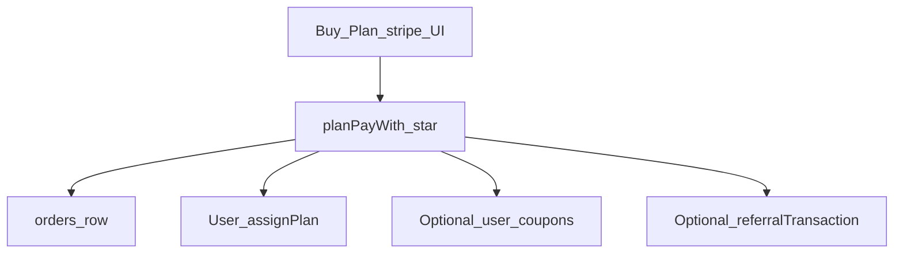

**Company upgrade paths:**

1. **Paid checkout** — `plans.index` → `GET /stripe/{encryptedPlanId}` → `stripe.blade.php` → gateway `planPayWith*` → `orders` + `assignPlan` + optional coupon/referral.
2. **Free trial** — `PlanController::planTrial` → trial fields + `assignPlan`.
3. **Plan request** — manual approve by super admin (§11.6).
4. **Super admin force** — `UserController::activePlan` → `assignPlan` + success `Order`.
5. **Refund** — may set `orders.is_refund` and `assignPlan(1)` (free plan).

Company listing typically shows plans where **`is_disable = 1` means enabled** (inverted flag name).

**`User::assignPlan($planID, $company_id = 0)` side effects:**

1. Set `users.plan` and `plan_expire_date` from duration (`month` / `year` / lifetime).
2. Resolve company id (`$company_id` or `creatorId()`).
3. Activate/deactivate that company’s users, clients, customers, vendors to enforce `max_*` (`-1` = unlimited).
4. Return success/error array.

### 11.6 Plan request workflow

1. Company: `request_send/{encryptedPlanId}` if `requested_plan == 0` → insert `plan_requests`, set `users.requested_plan`.
2. Super admin lists `plan_request.index`.
3. **Accept:** `assignPlan(plan_id, user->id)`, create manual `Order`, clear request.
4. **Reject / company cancel:** clear `requested_plan` and delete request rows.

### 11.7 Coupons and orders

**Coupons:** CRUD with `manage coupon`; apply via `GET /apply-coupon` (percent off, active + limit). On successful plan pay, write `user_coupons`; deactivate coupon when uses ≥ limit. **Not used for invoice customer payments.**

**Orders:** Created on successful (or pending bank) plan payment, plan-request accept, super-admin upgrade, etc. List at `GET /orders` — super admin sees all; company sees own. Bank pending orders await Approval/Rejected.

### 11.8 Referral program

1. Super admin configures `referral_settings` (percentage, minimum, enable flag).
2. On paid plan success: `Utility::referralTransaction($plan)` may credit referrer `commission_amount` once per company when referral code/program rules match.
3. Company requests payouts via `transaction_orders`; super admin accepts/rejects against threshold.

### 11.9 Dual payment contexts and gateways

| | (A) SaaS plan | (B) Customer invoice |
|--|---------------|----------------------|
| Settings | `admin_payment_settings` | `company_payment_settings` |
| Entry | Auth company → `/stripe/{plan}` | Public/customer invoice pay routes |
| Success | `orders` + `assignPlan` | `invoice_payments` |
| Coupons / referral | Yes | No |

**Method naming patterns:** `planPayWith*` (A); `customerPayWith*` / `invoicePayWith*` / `addPayment` (B). Same controller class often implements both.

**Major gateway controllers** (plan + invoice dual where present):  
`StripePaymentController`, `PaypalController`, `PaystackPaymentController`, `FlutterwavePaymentController`, `RazorpayPaymentController`, `PaytmPaymentController`, `MercadoPaymentController`, `MolliePaymentController`, `SkrillPaymentController`, `CoingatePaymentController`, `PaymentWallPaymentController`, `BankTransferPaymentController`, `ToyyibpayController`, `PayFastController`, `IyziPayController`, `SspayController`, `PaytabController`, `BenefitPaymentController`, `CashfreeController`, `AamarpayController`, `PaytrController`, `YooKassaController`, `MidtransPaymentController`, `XenditPaymentController`, `NepalstePaymnetController`, `PaiementProController`, `CinetPayController`, `FedapayController`, `PayHereController`, `TapController`, `AuthorizeNetController`, `KhaltiController`, `EasebuzzController`, `OzowPaymentController`.

Routes: plan pay cluster ~`routes/web.php` 2017+ (auth); customer invoice pay cluster ~633–751 (often lighter auth).

### 11.10 Bank transfer for plans

`BankTransferPaymentController::planPayWithBank`:

1. Upload `payment_receipt` → `uploads/order`.
2. Optional coupon discount.
3. Create `Order` with `payment_type = 'Bank Transfer'`, status **`Pending`** — plan **not** assigned yet.
4. Super admin Approval → set plan + `assignPlan` + referral; Rejected → mark rejected.

Invoice bank transfer is a parallel pending → company approval path into `invoice_payments`.

Admin toggles: `is_bank_transfer_enabled`, `bank_details` in platform payment settings / Bank tab on checkout UI.

### 11.11 Permissions

| Permission | Use |
|------------|-----|
| `manage/create/edit plan` | Plan CRUD / index (controller often checks `manage plan`) |
| `manage company plan` | Company “Setup Subscription Plan” menu |
| `manage coupon` (+ create/edit/delete) | Coupons |
| `manage order` | Orders menu / listing |
| `buy plan` | Often seeded but **unused** in controllers/views |

Plan Request / Referral menus rely mainly on user type, not Spatie gates.

### 11.12 Gotchas

1. **`is_disable = 1` means plan is enabled** — inverted naming.
2. **Dual contexts in one controller** — always check admin vs company settings and method name.
3. **Company menu vs controller gates** — menu may check `manage company plan` while index requires `manage plan` (seed usually grants both).
4. **Bank plan pay stays Pending** until super-admin approval — do not assume instant `assignPlan`.
5. **No `ReferralProgram` model** — settings/transactions/payout tables only.
6. **Inconsistent method/typo names** across gateways (`invoicePayWith*` vs `customerPayWith*`, `NepalstePaymnetController`, etc.).
7. **Coupon on bank pending** may record `user_coupons` before approval.
8. **`assignPlan` trial-clear logic** historically has a fragile empty `if` — verify when changing trial behavior.
9. Do not confuse SaaS `BankTransferPaymentController` with accounting `BankTransferController`.

---

## 12. Collaboration

**Scope:** Support System, Zoom Meeting, Messenger (Chatify)  
**Menu:** `resources/views/partials/admin/menu.blade.php` (~1624–1644 for staff; clients get Support only ~1791+)  
**Not this section:** HR **Meeting** (`manage meeting` / `meeting.index`) is a separate HR calendar feature — see [§5](#5-hrm)

### 12.1 Purpose and who uses it

| Feature | Audience | Purpose |
|---------|----------|---------|
| Support System | Company/staff + clients | Internal tickets with replies/attachments |
| Zoom Meeting | Company/staff (Spatie-gated) | Schedule Zoom meetings; optional project members / calendar |
| Messenger | Company/staff (not client / not super admin in menu) | Real-time chat via Chatify + Pusher |

Super admin has **no** Support / Zoom / Messenger sidebar items.

### 12.2 Folder map

| Feature | Controllers | Models | Views |
|---------|-------------|--------|-------|
| Support | `SupportController` | `Support`, `SupportReply` | `support/` |
| Zoom | `ZoomMeetingController` + `ZoomMeetingTrait` | `ZoomMeeting` | `zoom-meeting/`; settings in `settings/company.blade.php` |
| Messenger | `app/Http/Controllers/vendor/Chatify/MessagesController` | `ChMessage`, `ChFavorite` | `resources/views/vendor/Chatify/`; assets `public/css|js/chatify/` |

### 12.3 Key tables / config

| Piece | Purpose |
|-------|---------|
| `supports`, `support_replies` | Tickets and thread replies |
| `zoom_meetings` | Local Zoom meeting records (API ids, URLs, members CSV) |
| `settings` keys `zoom_account_id`, `zoom_client_id`, `zoom_client_secret` | Zoom Server-to-Server OAuth |
| `ch_messages`, `ch_favorites` | Chatify messages / favorites |
| `config/chatify.php` | Prefix **`chats`**, middleware `web,auth,XSS,pusher` |
| Pusher (super-admin settings) | Injected by `pusherConfig` middleware from `Utility::settingsById(1)` |

### 12.4 Menu and routes

| Item | Route / URL | Notes |
|------|-------------|--------|
| Support System | `support.index` | Staff + clients |
| Zoom Meeting | `zoom-meeting.index` | Staff; calendar `zoom-meeting-calender` |
| Messenger | `url('chats')` | Staff; unread badge in admin header |

**Support routes** (`web.php` ~2125–2138): `support` resource, `support.reply`, `support.reply.answer`, `support.grid`.  
**Zoom routes** (~2215–2218): `zoom-meeting` resource, project user select, calendar, get data; `zoom.settings` POST for credentials.  
**Chatify routes:** package provider loads under prefix `/chats` (not listed in app `web.php`).

### 12.5 Support ticket flow

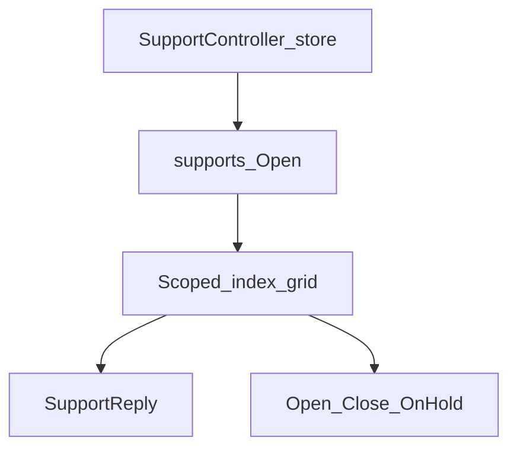

1. **Create:** validate subject/priority; `ticket_code = date('hms')`; status forced **`Open`** (form status often ignored); optional attachment under `uploads/supports`; `created_by = creatorId()`, `ticket_created = Auth::id()`; company can assign `user`, others assign self.
2. **List:** company sees all for `creatorId()`; others see tickets assigned to them under same tenant.
3. **Update:** status from `Support::status()` → Open / Close / On Hold; company can reassign.
4. **Reply:** encrypted id on GET; marks replies read; POST creates `SupportReply`. UI typically allows comments only while status is Open.
5. **Priorities:** Low / Medium / High / Critical.

**Authz:** no Spatie Support permissions — gated by auth + type scoping only.

### 12.6 Zoom meeting flow

**Settings:** company settings → Zoom Account ID / Client ID / Client Secret → `SystemController::saveZoomSettings`.

**API:** `ZoomMeetingTrait::getToken` — Server-to-Server OAuth to `zoom.us/oauth/token`, then Zoom API v2 (`users/me/meetings`).

**Create** (`create zoom meeting`):

1. Require all three Zoom settings (else “Api key is wrong”).
2. Call Zoom create meeting; store local row with `meeting_id`, `start_url`, `join_url`, member CSV `user_id`, optional `project_id` / `client_id`, status.
3. Optional Google Calendar sync when `synchronize_type == google_calender`.
4. Project members via AJAX `zoom-meeting/projects/select/{id}`.

Permissions: `manage/create/show/delete zoom meeting` (seeded for company role). Edit/update stubs may be empty; calendar UI available.

### 12.7 Messenger (Chatify)

- Package: `munafio/chatify` ^1.5; published controller/views under app `vendor/Chatify`.
- URL prefix: **`/chats`**.
- Middleware `pusher` → `app/Http/Middleware/pusherConfig.php` loads Pusher keys from **platform** settings (`settingsById(1)`), not per-company.
- Contacts: company/staff under same tenant; clients excluded from member list.
- Header Messenger icon + unread count from `ChMessage` (`to_id`, `seen = 0`).
- Realtime: private Chatify channel + `pusherAuth`.

### 12.8 Permissions

| Feature | Permissions |
|---------|-------------|
| Support | None (type/auth scoping only) |
| Zoom | `manage/create/show/delete zoom meeting` |
| Chatify | None (menu by user type) |

### 12.9 Integrations / notifications

| Feature | Integrations |
|---------|--------------|
| Support create | Slack / Telegram / email template `new_support_ticket` / webhook “New Support Ticket”; optional AI generate/grammar |
| Zoom | Google Calendar; AI template module key `zoom meeting` |
| Chatify | Pusher (super-admin credentials); header unread badge |

### 12.10 Gotchas

1. **Support status case mismatch** — store uses `Open`/`Close`/`On Hold` while some counters query lowercase → counts can stay 0.
2. **Create form status ignored** — always saved as Open.
3. **`ticket_code = date('hms')`** — collision risk; not a proper sequence.
4. **No Support ACL** — harden if tickets are sensitive.
5. **Zoom `client_id` form bugs** — checkbox/`Project` misuse can break client association.
6. **Zoom create timezone** may be hardcoded (e.g. `Asia/Kolkata`) while other paths use `config('app.timezone')`.
7. **`meeting_id` as integer** may truncate large Zoom IDs.
8. **Chatify Pusher is global** (`settingsById(1)`), not per tenant.
9. **Do not confuse** HR Meeting with Zoom Meeting.
10. Clients see Support in menu but not Messenger/Zoom (Zoom may still be reachable by URL if permitted).

---

## 13. LandingPage module

**Type:** nwidart module (`Modules/LandingPage/`)  
**Enable:** `modules_statuses.json` → `"LandingPage": true`  
**Alias / views:** `landingpage::`  
**Access:** super admin CMS only (`type == 'super admin'`); no Spatie permissions  
**Cross-ref:** plans/pricing cards use core [`Plan`](#35-plans-and-feature-gating); register/Stripe checkout in [§11](#11-saas-billing-and-payments)

### 13.1 Purpose

Marketing CMS for the public SaaS landing site: top bar, home hero, features, discover, screenshots, pricing copy, FAQ, testimonials, custom menubar pages, and join-us email capture. Plan **rows** still live in core `plans`; this module only stores marketing content and toggles.

### 13.2 Enablement and bootstrap

| Piece | Path / behavior |
|-------|-----------------|
| Manifest | `Modules/LandingPage/module.json` — providers `LandingPageServiceProvider`, `AddMenuProvider` |
| Status | `modules_statuses.json` via nwidart file activator (`config/modules.php`) |
| Seed | `DatabaseSeeder` runs `module:migrate LandingPage` then `module:seed LandingPage` |
| Public gate | Core setting `display_landing_page == 'on'` **and** table `landing_page_settings` exists |

### 13.3 Module structure

| Area | Contents |
|------|----------|
| Controllers | `LandingPageController`, `HomeController` (admin home CMS), `FeaturesController`, `DiscoverController`, `ScreenshotsController`, `PricingPlanController`, `FaqController`, `TestimonialsController`, `CustomPageController`, `JoinUsController` |
| Entities | `LandingPageSetting`, `JoinUs` |
| Routes | `Modules/LandingPage/Routes/web.php` (+ stub `api.php`) |
| Views | Admin under `Resources/views/landingpage/`; public `layouts/landingpage.blade.php`, `layouts/custompage.blade.php`; CMS tabs `layouts/tab.blade.php`; menu `menu/landingpage.blade.php` |
| Migrations | `landing_page_settings`, `join_us` |
| Seeders | `LandingPageDatabaseSeeder` → `LandingPageDataTableSeeder` |

### 13.4 Admin CMS sections

Shared left nav: `layouts/tab.blade.php`. All gated to super admin.

| Section | Routes / controller | Data keys (settings) |
|---------|---------------------|----------------------|
| Top Bar | `landingpage` → `LandingPageController` | `topbar_status`, `topbar_notification_msg` |
| Custom Page / menubar | `custom_page`, `custom_store` → `CustomPageController` | `menubar_page` JSON, `site_logo`, `site_description` |
| Home | `homesection` → `HomeController` | Home status, titles, demo/buy links, banner/logo |
| Features | `features` + feature_* → `FeaturesController` | Feature section + JSON cards/highlights/`other_features` |
| Discover | `discover` → `DiscoverController` | Discover copy + JSON items |
| Screenshots | `screenshots` → `ScreenshotsController` | Status/heading + JSON screenshots |
| Pricing Plan | `pricing_plan` → `PricingPlanController` | Marketing copy only (`plan_status/title/heading/description`) |
| FAQ | `faq` → `FaqController` | FAQ section + JSON faqs |
| Testimonials | `testimonials` → `TestimonialsController` | Section + JSON testimonials |
| Join Us | `join_us` → `JoinUsController` | Join-us copy; emails in `join_us` table |

Images typically upload under `uploads/landing_page_image` via `LandingPageSetting::upload_file()` (local / Wasabi / S3 per storage settings).

### 13.5 Public rendering (important)

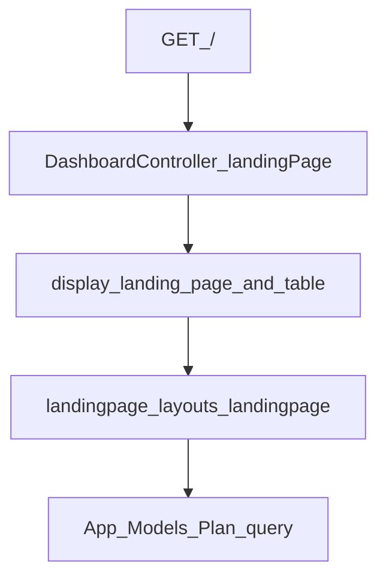

**Module `HomeController` is admin CMS only.** Public home is:

- `GET /` → `DashboardController::landingPage` → route name `landingpage.home`
- View: `landingpage::layouts.landingpage`
- If not installed / landing off / table missing → redirect to login

**Also public:**

- `GET pages/{slug}/{lang?}` → custom pages (`custom.page`)
- `POST join_us/store/` → join-us email store (no auth)

**Pricing cards** (in public blade): `Plan::orderBy('price','ASC')->get()` when CMS `plan_status` for locale is on; typically shows enabled paid plans (`is_disable == 1` and `price > 0`); currency from admin payment settings; CTAs → Stripe (logged in) or register with `?plan=` encrypted id.

### 13.6 Settings storage

Table `landing_page_settings`: unique `name`, `longtext value`.

`LandingPageSetting::settings()` / `landingPageSetting()` merge DB over defaults. Nested lists and many multilang fields stored as **JSON** in `value`; public layout `json_decode`s and indexes by `$lang`.

`join_us`: unique email list for newsletter-style capture.

### 13.7 Admin menu injection

**Working path:** hard-coded in super-admin block of `menu.blade.php`:

```blade
@include('landingpage::menu.landingpage')
```

**`AddMenuProvider`** pushes `@stack('add_menu')`, but **no view consumes that stack** — orphaned; include above is what actually shows “Landing Page”.

### 13.8 Permissions

None (Spatie). Controllers check `type == 'super admin'` on index; routes use `auth` + `XSS`. Public custom page / join-us are guest-accessible.

### 13.9 Integrations with core ERP

| Integration | How |
|-------------|-----|
| Plans | Read `App\Models\Plan` on public pricing |
| Register / Stripe | Guest register with encrypted plan; logged-in → `route('stripe', …)` |
| `display_landing_page` | Core company/platform settings |
| Languages / theme / cookie / SEO | `Utility` + `$adminSettings` in layout |
| Auth layout | Can include landing buttons for custom pages with login flag |
| Storage | Shared `Utility` storage helpers |
| Seeder / installer | Module migrate+seed on main seed; XSS middleware may count LandingPage migrations for updates |

### 13.10 Gotchas

1. **`HomeController` ≠ public home** — public is `DashboardController::landingPage`.
2. **`AddMenuProvider` ineffective** without `@stack('add_menu')`.
3. **Seeder vs multilang JSON** — seed may store plain strings while views expect `json_decode` + `[$lang]` → broken sections until CMS re-save.
4. **Free plans often hidden** on landing (`price > 0`).
5. **`is_disable` inverted** (same as billing) — `1` means shown/enabled.
6. Some upload/save paths have **wrong `upload_file` arity** or missing `json_encode` — verify when editing CMS writers.
7. Plan name i18n in blade may concat wrong property names (`name` + `_fr`) — check when fixing translations.
8. Admin store methods may not re-check super admin on every action (rely on auth + obscurity).

---

## 14. HotelManagement module

**Type:** nwidart module (`Modules/HotelManagement/`)  
**Enable:** `modules_statuses.json` → `"HotelManagement": true`  
**Alias / views:** `hotelmanagement::`  
**Provider:** `Modules\HotelManagement\Providers\HotelManagementServiceProvider`  
**Cross-ref:** POS charge-to-room [§9](#9-pos); inventory stock [§8](#8-inventory--products); accounting journals/invoices [§4](#4-accounting)

Product vision / roadmaps live in separate docs — see [§14.10](#1410-related-docs-do-not-duplicate). This section describes **current code architecture**.

### 14.1 Purpose and enablement

PMS for multi-tenant hotels: rooms, reservations, front desk, folios, housekeeping, night audit, rate plans, groups, minibar, public booking, Stripe prepay, POS/accounting links, and reports.

| Piece | Behavior |
|-------|----------|
| Menu | `menu.blade.php` includes `hotelmanagement::menu.hotelmanagement` when module views are registered |
| Menu gates | Blade uses Laravel Gates `hotel.menu.*` → `HotelAuthorization` → Spatie hotel permissions |
| Auth routes | `Routes/web.php` under `hotel/...` (+ `/hotel-dashboard`); middleware auth / XSS / revalidate / verified |
| Public routes | `Routes/public_booking.php` as `/{hotelSlug}/…`; Stripe webhook `webhooks/hotel-stripe` |
| API | `Routes/api.php` is essentially a stub ping — not a full PMS API |
| Schedule | Birthday promotions, OTA sync (stub), daily owner summary, low-occupancy alert |

### 14.2 Module structure

| Layer | Contents |
|-------|----------|
| Controllers (~29) | Dashboard, reservations, calendar, frontdesk, folio, housekeeping, night audit, floors/types/rooms, rate plans, addons, minibar/consumption, guests/groups, accounting settings, cashier shifts, expenses, POS integration, OTA, booking site, public booking, Stripe webhook, reports |
| Entities (~26) | Floors, room types/rooms, rate plans, addons, guests, groups, reservations, stays, folios/lines/payments, housekeeping, night audits, minibar/restock/consumption, accounting/OTA/booking site/checkout, cashier shifts, expenses |
| Services (~20) | Auth, pricing, check-in, stay ops, room status, housekeeping, POS charge, folio payment/accounting/invoice, stock deduction, public booking/availability, Stripe, CRM sync, night-audit preview, petty cash, … |
| Concerns | `AuthorizesHotelAccess`, `BuildsRoomMap`, `RendersHotelReports` |
| Migrations | ~38 (core PMS + floors/groups/payments/OTA/accounting/minibar/booking/cashier/permissions) |
| Tests | `tests/Feature/HotelManagement/*`, `tests/Unit/HotelManagement/*` |

### 14.3 Domain sub-areas

| Area | What it does |
|------|----------------|
| Rooms / types / floors | CRUD; room statuses `available\|occupied\|dirty\|cleaning\|maintenance\|blocked`; branch/floor; map/bulk status |
| Rate plans | **Price per Period** (menu): per room type rates, billing mode, validity dates, priority, optional **weekend_rate** (Fri–Sun promo). Quoted nightly stays sum per-night weekday/weekend rates. |
| Reservations / calendar | Resource + quotes/suggest room; statuses `pending\|confirmed\|checked_in\|checked_out\|cancelled`; calendar drag, extend, change room |
| Front desk | In-house list; check-in/out; force checkout; heal occupancy mismatches |
| Guests | Profiles/map; created with reservations/online (no standalone create route); optional CRM sync → ERP `Customer` |
| Groups | Group + member reservations in one transaction |
| Folio | Lines (room/POS/minibar/laundry/addon/misc); payments (cash, mpesa, card, bank_transfer, e_mola, mkesh); receipts; tax invoice PDF |
| Housekeeping | Tasks; post-checkout / night-audit dirty queues; minibar restock |
| Night audit | Preview/run/export; closes business day with POS orchestrator; writes `HotelNightAudit` |
| Minibar | Catalog + consumption logs; optional ERP product/warehouse deduct; restock; optional scan-at-checkout |
| Addons | Extra bed, breakfast, parking, laundry, other |
| POS integration | In-house guests JSON + charge-to-folio; also from core `PosController` |
| Accounting settings | Guest AR, revenue COAs, VAT, bank map, POS invoice-when-charge-to-room, minibar scan flag |
| Public booking | `HotelBookingSite` slug/branding; pay-at-hotel or Stripe prepay; availability + confirmation token |
| OTA | Settings UI + scheduled command — **sync is stub** (logs only) |
| Cashier / expenses | Hotel cashier shifts; expenses + petty cash helpers |
| Reports | Operational, financial, immigration, occupancy, alerts; financial/ops report suites (+ export where wired) |

### 14.4 Core flows

#### Reservation → check-in → folio → payment → check-out

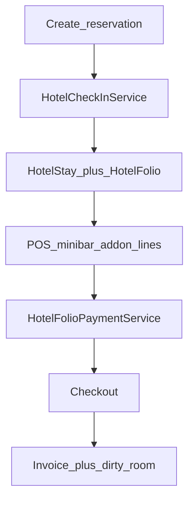

1. Create reservation (manual / group / online) with room type ± room, rate quote, addons.
2. **Check-in** (`HotelCheckInService::ensureStayAndFolio`): requires room; creates stay (`in_house`) + folio + `room_charge`; posts reservation addons; room → `occupied`; reservation → `checked_in`.
3. During stay: POS/minibar/laundry/misc/addon lines on folio.
4. **Payments** via `HotelFolioPaymentService` (+ optional payment journals).
5. **Check-out:** unpaid blocked unless `force hotel checkout`; optional minibar verify; finalize AR journal if configured; `HotelFolioInvoiceService::createInvoiceFromFolio`; stay/reservation checked out; room dirty + minibar restock queued; folio `settled` if paid.

#### Night audit

1. Preview for audit date (`HotelNightAuditPreviewService`).
2. Block if business day already locked / audit exists for branch+date.
3. `NightAuditOrchestratorService::closeBusinessDay` (shared with POS).
4. Persist `HotelNightAudit`; queue dirty rooms; export/print.

#### Public booking

1. Resolve tenant by published site slug (`ResolveHotelBookingTenant` → `hotel_tenant_id` = site `created_by`).
2. Availability → book → guest + confirmed reservation (`source=online`, `WEB-…`).
3. Pay-at-hotel vs Stripe prepay (`HotelBookingCheckout` + webhook/success).
4. Confirmation via hashed token.

### 14.5 Tenancy

- Hotel records use `created_by = Auth::user()->creatorId()` (company owner id).
- Controllers scope and reject cross-tenant IDs.
- Public booking tenant = `HotelBookingSite.created_by` (no logged-in user).
- Many ops also use active branch context (`activeBranchContextId()`).

### 14.6 Integrations

| System | How |
|--------|-----|
| POS | `HotelPosChargeService::chargeToFolio` (`pos_charge`, `source_pos_id`) |
| Inventory | `HotelStockDeductionService` for product-backed minibar (warehouse/lots/ledger); oversell often floored at 0 |
| Accounting | `HotelFolioAccountingService` → `JournalEntryPoster` (AR / revenue / VAT); skipped if COA incomplete |
| ERP Invoice | `HotelFolioInvoiceService` at checkout |
| CRM | Guest → `Customer` via `HotelGuestCrmSyncService` |
| Business day | Shared `NightAuditOrchestratorService` + `BusinessDayLockService` |
| Mail | Reservation created mail on online booking |

### 14.7 Permissions

Catalog: `app/Services/HotelPermissionCatalog.php` (also injected on role create/edit UI).

| Permission | Typical use |
|------------|-------------|
| `manage hotel` | Full module |
| `show hotel dashboard` | Dashboard / report view |
| `manage/show hotel room` | Rooms, types, floors, rates |
| `manage/show hotel reservation` | Reservations, calendar, groups, booking site/OTA manage |
| `manage/show hotel frontdesk` | Check-in/out, HK, night audit, accounting settings |
| `show hotel folio` | Folio view |
| `force hotel checkout` | Override unpaid checkout |

POS charge also allows users who `canManagePos()`. Ensure via `HotelPermissionCatalog::ensurePermissionsExist()`.

### 14.8 Scheduled jobs

| Command | Role |
|---------|------|
| Birthday promotions | ~08:00 |
| `hotelmanagement:ota-sync` | Every 15m — **stub** |
| Daily owner summary | ~22:00 |
| Low-occupancy alert | ~09:30 |
| `HotelE2eDemoCommand` | Demo/E2E helper |

### 14.9 Gotchas

1. **API routes are not a real PMS API** — do not document as public REST surface.
2. **OTA sync is stub** — settings/UI exist; providers not implemented.
3. **Public `/{slug}` catch-all** — keep `HotelBookingSite::RESERVED_SLUGS` aligned with app routes.
4. **Accounting may silently skip** journals/invoices when COA incomplete.
5. **Unpaid checkout** needs force permission; balance can remain.
6. **Night audit closes POS business day** via shared orchestrator — not hotel-only.
7. **Blade Gates ≠ raw Spatie names** — menu uses `hotel.menu.*`.
8. **Guests have no standalone create route** — created via reservation/online paths.
9. **Plan docs may be stale** — verify gaps against code before treating completion plans as current truth.
10. Dual minibar paths: hotel catalog items vs ERP `ProductService` warehouse consumption.

### 14.10 Related docs (do not duplicate)

| Doc | Use for |
|-----|---------|
| [`docs/hotel/doc.md`](hotel/doc.md) | Product vision / POS+ERP hotel intent |
| [`docs/hotel/client-feedback.md`](hotel/client-feedback.md) | Client UX/feature asks |
| [`Modules/HotelManagement/docs/HOTEL_MODULE_COMPLETION_PLAN.md`](../Modules/HotelManagement/docs/HOTEL_MODULE_COMPLETION_PLAN.md) | Historical phased completion plan — re-verify |
| [`Modules/HotelManagement/docs/HOTEL_CLIENT_REQUIREMENTS_PLAN.md`](../Modules/HotelManagement/docs/HOTEL_CLIENT_REQUIREMENTS_PLAN.md) | Round-2 requirements matrix |
| [`Modules/HotelManagement/docs/HOTEL_DIRECT_BOOKING_WEBSITE_PLAN.md`](../Modules/HotelManagement/docs/HOTEL_DIRECT_BOOKING_WEBSITE_PLAN.md) | Public booking architecture rationale |

---

## 15. Reports and tax / compliance

**Canonical menu:** Dashboard report trees in `resources/views/partials/admin/menu.blade.php`  
**Primary hub:** `ReportController` + specialized monthly/annual controllers and services  
**Plan gates:** Accounting / HRM / CRM / POS / stock report trees require matching `$userPlan->*` flags  
**Cross-ref:** Accounting GL (`transaction_lines`) [§4](#4-accounting); payroll/IRPS [§5](#5-hrm); POS EOD [§9](#9-pos); Hotel reports [§14](#14-hotelmanagement-module)

### 15.1 Purpose

Two layers of reporting:

1. **Operational / management** — income, sales, AR/AP, stock, payroll, CRM, POS dashboards and Excel exports  
2. **Statutory / Mozambique-oriented** — VAT Modelo A, Balancete, IRPS Modelo 19/22, IRPC guide, comparative DRE (PCGAP/SNC-style CoA codes)

Module **dashboards** (`DashboardController`) are overview widgets scoped by `creatorId()`; detailed reports live under Dashboard → Reports (and Product / POS / Hotel menus).

### 15.2 Controllers and services

| Class | Role |
|-------|------|
| `ReportController` | Most management / HRM / CRM / POS / financial reports + many Excel exports |
| `MonthlyVatReportController` | VAT Modelo A + XLSX template fill |
| `MonthlyReportController` | Government Balancete (trial balance) + PDF |
| `MonthlyIrpsReportController` | IRPS Modelo 19 & 22 + PDF |
| `IrpcReportController` | Annual IRPC payment guide + PDF |
| `DreReportController` | Comparative DRE + Excel |
| `HrmTaxReportController` | HRM withholdings / loans |
| `ProductReportsController` | Product-system inventory reports |
| `CreditDebitNoteReportsController` | Credit/debit note lists |
| `AnalyticalReportController` | PowerBlox placeholder |
| `ReportSectionsController` | Section landing pages |
| `DashboardController` | Module dashboards (account/hrm/crm/pos/sales/project) |
| `TrialBalanceReportService` | TB / Balancete aggregation |
| `DreDemonstracaoResultadosService` | Comparative P&L by CoA codes |
| `IrpcCalculationService` | IRPC from DRE × rate |
| `IrpsModel22ReportService` | Payslip IRPS/INSS breakdown |
| `BalanceSheetReportService` | Balance sheet |

Config: `config/fiscal_closing.php` (VAT CoA prefixes, `irpc_rate` / `FISCAL_IRPC_RATE`).

### 15.3 Menu map (major trees)

#### Accounting Reports (plan `account`)

| Group | Examples (route names) |
|-------|------------------------|
| Monthly statutory | `monthly.reports.vat-modelo-a`, `monthly.reports.trial-balance`, `monthly.reports.irps-modelo-19`, `monthly.reports.irps-modelo-22`, `annual.reports.irpc-payment-guide` |
| Management | Account statement, invoice/bill summary, sales, receivables, payables, product stock, cash flow, income/expense/tax summaries, credit/debit notes |
| Analytical | `reports.analytical.powerblox` (placeholder) |
| Financial statements | Ledger, balance sheet, P&L, DRE comparative (`report.dre.comparativa`), classic trial balance (`trial.balance`) |

#### Product system (`stock report`)

`reports.product.index`, store-check, warehouse-stock, transactions, last-supplies, location-check.

#### HRM (`manage report`)

Payroll, leave, monthly attendance, `report.hrm.tax`.

#### CRM

Lead / deal reports (`report.lead`, `report.deal`).

#### POS (`manage pos`)

Warehouse, purchase/POS daily-monthly, POS vs purchase, POS by branch; extras: EOD, shift, day summary, low stock, restaurant suite.

### 15.4 Mozambique / statutory pack

| Report | What it does | Key files |
|--------|----------------|-----------|
| **VAT Modelo A** | Monthly IVA fields from `transaction_lines` by CoA prefixes (e.g. `71`/`72`, VAT `443*`); some boxes manual; export fills `Modelo A.xlsx` | `MonthlyVatReportController`; `reports/monthly/vat_modelo_a*` |
| **Trial Balance (Balancete)** | Government-style TB; fiscal year + periods `0–15` | `MonthlyReportController` + `TrialBalanceReportService` |
| **Classic Trial Balance** | Same service, management UI | `ReportController::trialBalanceSummary` / `trial.balance` |
| **IRPS Modelo 19** | Aggregate remittance form; some lines auto from payslips/revenues, many manual | `MonthlyIrpsReportController::modelo19` |
| **IRPS Modelo 22** | Per-employee earnings / INSS / IRPS (payslip + recalculated progressive table) | `modelo22` + `IrpsModel22ReportService` |
| **IRPC guide** | Annual corporate tax estimate from DRE × rate (default ~32%); prior payments often 0 | `IrpcReportController` + `IrpcCalculationService` |
| **DRE comparative** | Two-year Demonstração dos Resultados (6xx costs / 7xx revenues) | `DreReportController` + `DreDemonstracaoResultadosService` |

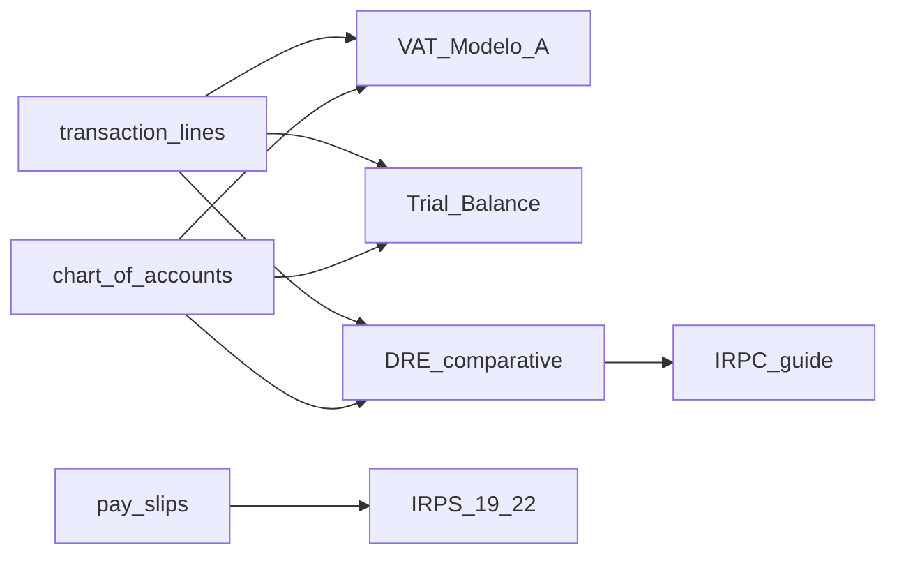

### 15.5 Other report families (brief)

| Family | Sources | Notes |
|--------|---------|--------|
| Income / expense / tax summaries | `revenues`, `payments`, invoices/bills, taxes | Calendar year columns |
| Sales / AR / AP | invoices, bills, credit/debit notes | Some controllers lack `can()` beyond auth |
| Product system | `product_services`, `warehouse_products`, `stock_reports`, purchases | `stock report` |
| HRM | `pay_slips`, leaves, attendance | `manage report` |
| CRM | leads, deals | Soft authz |
| POS | `pos`, purchases, warehouses, shifts | `canManagePos()`; day close often company owner only |

### 15.6 Scoping and filters

- **Tenant:** almost always `created_by = Auth::user()->creatorId()` (exceptions: some POS warehouse / CRM charts use `Auth::id()` — see gotchas).
- **Dates:** year+month (VAT/IRPS); fiscal year + accounting period (Balancete); year1/year2 (DRE); start/end or YTD (P&L/BS/sales); `salary_month` for payroll/IRPS.

### 15.7 Export formats

| Format | Used by |
|--------|---------|
| Excel (Maatwebsite) | Trial balance, BS, P&L, sales, receivables, statement, stock, payroll, leave, POS EOD/shift, DRE, … |
| PhpSpreadsheet template | VAT Modelo A → project-root `Modelo A.xlsx` |
| PDF (DomPDF or Browsershot) | Balancete, IRPS 19/22, IRPC guide |
| Screen only | PowerBlox placeholder, many summaries |

### 15.8 Permissions (patterns)

| Pattern | Examples |
|---------|----------|
| Named report perms | `tax report`, `trial balance report`, `invoice report`, `stock report`, `income vs expense report`, … |
| Broad | `manage report` (HRM + some IRPS + CN/DN) |
| Reused oddly | Balance sheet menu uses **`bill report`** |
| Soft / missing `@can` | Sales, receivables, payables, some credit/debit menu items |
| Plan + dashboard | Module trees need plan flag + `show * dashboard` |

### 15.9 Gotchas

1. **Two trial balances** — classic `trial.balance` vs government `monthly.reports.trial-balance` (same service, different views).
2. **`Modelo A.xlsx` must exist at project root** or VAT export fails.
3. **Statutory numbers depend on CoA codes** — wrong chart → wrong VAT/DRE/IRPC.
4. **IRPC is simplified** — DRE profit × rate; little tax adjustment logic; prior payments often 0.
5. **IRPS 19 is hybrid** — many lines manual; Modelo 22 may show both stored and recalculated IRPS.
6. **Permission mismatches** — BS vs `bill report`; PowerBlox menu vs `manage report` in controller.
7. **PDF needs DomPDF or Node/Browsershot** configured.
8. **POS warehouse report** may scope warehouses by `user()->id` not `creatorId()`.
9. **PowerBlox is a stub**, not wired to live ERP datasets.
10. Hotel has its **own** report controllers under the Hotel module — not this Dashboard tree.

---

## 16. Deployment and operations

**Cross-ref:** local Laragon setup in [§2](#2-setup-and-environment); module flags in [§13](#13-landingpage-module) / [§14](#14-hotelmanagement-module)  
**Stack:** PHP ^8.2, Laravel ^11.9  
**Do not duplicate:** SQL dumps under `docs/sql/` — link only ([§16.8](#168-related-ops-docs))

### 16.1 Production environment checklist

From `.env.example` + config (set properly for production):

| Area | Keys / notes |
|------|----------------|
| App | `APP_ENV=production`, `APP_DEBUG=false`, valid `APP_KEY`, correct `APP_URL` |
| Database | `DB_*` MySQL credentials |
| Cache / session | Default `file`; use `redis`/`database` for high-traffic POS |
| Queue | Default `QUEUE_CONNECTION=sync`; use `database` or `redis` + worker for async |
| Mail | Real SMTP (not Mailhog) |
| Files | Prefer matching `config/filesystems.php` (`FILESYSTEM_DRIVER` — `.env.example` may say `FILESYSTEM_DISK`) |
| AWS / S3 | Optional env; app also uses **super-admin Storage settings** in DB |
| Redis | Required if queue/cache/session use Redis |
| Health | Laravel `/up` endpoint (`bootstrap/app.php`) |

Installer permission expectations (`config/installer.php`): writable `storage/`, `bootstrap/cache/`, related dirs; PHP **8.2+**.

### 16.2 Deploy / update sequence

No project-specific deploy script in-repo. Typical production update:

```bash
composer install --no-dev --optimize-autoloader
# post-autoload-dump runs package:discover + module:discover

npm ci   # or npm install
npm run build

php artisan migrate --force
php artisan module:migrate
# optional: php artisan module:seed <Module>

php artisan storage:link

php artisan config:cache
php artisan route:cache
php artisan view:cache

# if using queue workers:
php artisan queue:restart
```

Debug / clear: `php artisan optimize:clear`.

### 16.3 Queues

| Mode | Behavior |
|------|----------|
| `sync` (default) | Jobs run inline; no worker process |
| `database` | Needs `jobs` / `failed_jobs` tables; run `php artisan queue:work` |
| `redis` | Needs Redis; `php artisan queue:work redis` |

After code deploy with workers running: `php artisan queue:restart`.

### 16.4 Scheduler / cron

**Production cron (required for schedules):**

```cron
* * * * * cd /path/to/erp-saas && php artisan schedule:run >> /dev/null 2>&1
```

**Active schedules** (Hotel module when enabled + console routes):

| When | Command |
|------|---------|
| Daily 08:00 | `hotelmanagement:send-birthday-promotions` |
| Every 15 min | `hotelmanagement:ota-sync` (stub) |
| Daily 22:00 | `hotelmanagement:daily-owner-summary` |
| Daily 09:30 | `hotelmanagement:low-occupancy-alert` |
| Hourly | `inspire` (demo; from `routes/console.php`) |

**Note:** `stock:alerts` (`SendStockAlerts`) exists as a command but may **not** be on the active Laravel 11 schedule (legacy `app/Console/Kernel.php` schedule is often unused). Run manually or register in `routes/console.php` / module provider if needed. Verify with `php artisan schedule:list`.

### 16.5 Modules enable / disable

Edit `modules_statuses.json`:

```json
{
    "LandingPage": true,
    "HotelManagement": true
}
```

Then:

```bash
php artisan module:discover
php artisan module:migrate
```

Config: `config/modules.php` (file activator → `modules_statuses.json`).

### 16.6 Installer and updater

- Package: `rachidlaasri/laravel-installer`
- Marker file: `storage/installed`
- Super admin XSS middleware may detect pending migrations and redirect to Laravel Updater / run `Utility::addNewData()`
- Prefer `php artisan migrate --force` (+ `module:migrate`) for controlled deploys

### 16.7 Storage, backup, cache (ops UI)

| Concern | How |
|---------|-----|
| Storage modes | Super admin Settings → Storage: `local` \| `s3` \| `wasabi` via `SystemController::storageSettingStore`; values in `settings` (often read as `created_by = 1`) |
| Cache clear | Settings Cache Clear → `cache:clear` + `optimize:clear`; also `GET /config-cache` (verify auth exposure in your environment) |
| DB backup | Settings “Get new backup” → PHP SQL dump under `storage/app/backups/` + `Backup` model row; download via backup routes |

### 16.8 Related ops docs (link only)

| Doc | Purpose |
|-----|---------|
| [`docs/OLD_DB_MIGRATION_GAP.md`](OLD_DB_MIGRATION_GAP.md) | Old live dump vs repo migrations (pending list, missing tables); prefer `migrate --force` |
| [`docs/pending_migrations.txt`](pending_migrations.txt) | Bare migration basename list |
| [`docs/sql/`](sql/) | Hand SQL for missing tables/columns on old dumps — use only when migrate path is blocked |
| [`docs/missing_tables_in_old_db.txt`](missing_tables_in_old_db.txt) | Missing table names |
| [`docs/tables_only_in_old_dump.txt`](tables_only_in_old_dump.txt) | Legacy tables in old dump without repo `Schema::create` |

### 16.9 Troubleshooting

| Symptom | Check |
|---------|--------|
| Uploads / logs fail | `storage/` + `bootstrap/cache/` writable; `storage:link` |
| Module menu missing | `modules_statuses.json`, `module:discover`, migrate |
| `No application encryption key` | `php artisan key:generate` |
| Super admin forced into updater | Pending migrations — run migrate / module:migrate |
| Stale config/routes | `optimize:clear` then re-cache |
| Jobs never process | Still on `sync`, or no `queue:work` |
| Hotel cron jobs idle | System cron not calling `schedule:run`; module disabled |
| `FILESYSTEM_DISK` ignored | Align with `FILESYSTEM_DRIVER` / filesystems config |
| Old DB schema gaps | Follow `OLD_DB_MIGRATION_GAP.md` — migrate first, SQL scripts last resort |

### 16.10 Gotchas

1. Default queue is **sync** — async features need explicit worker + connection change.  
2. Scheduler does nothing without OS cron → `schedule:run`.  
3. `stock:alerts` may need manual registration if you expect daily low/max stock emails.  
4. Super-admin storage settings in DB can override env AWS for uploads.  
5. Hand SQL in `docs/sql/` can drift from newer migrations — prefer Artisan migrate when possible.

---

## 17. Glossary

| Term | Meaning |
|------|---------|
| Company / tenant | `users` row with `type = company` |
| `creatorId()` | Active company owner id used to scope tenant data |
| `created_by` | Column storing tenant owner id on most business tables |
| Plan | Subscription package with feature flags (`account`, `hrm`, `crm`, `project`, `pos`, `stock`, `chatgpt`) and limits |
| Spatie permission | ACL string such as `manage invoice`, `manage pos` |
| nwidart module | Optional package under `Modules/` toggled via `modules_statuses.json` |
| Impersonation | Super admin “login as company” via Lab404 |
| Branch | Operational sub-unit inside a company (POS/HR/Hotel) |
| `transaction_lines` | Operational GL lines for documents and journals |
| Folio | Hotel guest bill (charges + payments) during a stay |
| POS shift / EOD | Cashier shift and end-of-day close for POS |
| Balancete | Government-style trial balance report |
| Modelo A / IRPS / IRPC | Mozambique-oriented VAT / payroll / corporate tax reports |
| `assignPlan` | Applies plan id, expiry, and activates/deactivates users to enforce limits |
| Chatify | Messenger package mounted at `/chats` |
| Landing CMS | Super-admin marketing site content in LandingPage module |

---

*Documentation complete (Sections 1–17). Single source file: `docs/TECHNICAL.md`.*
